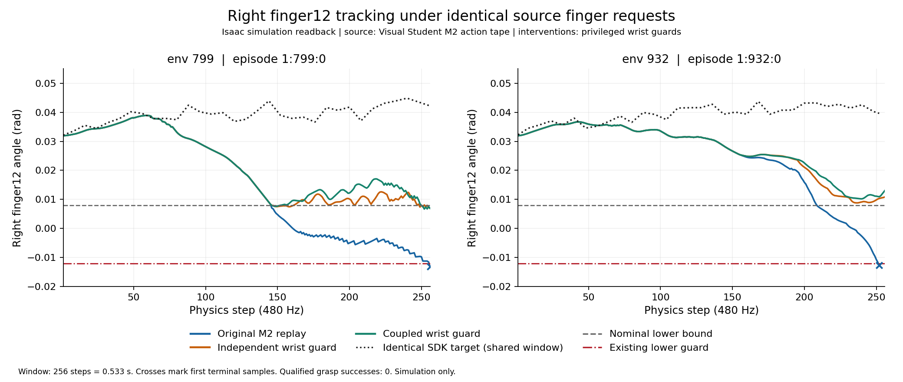
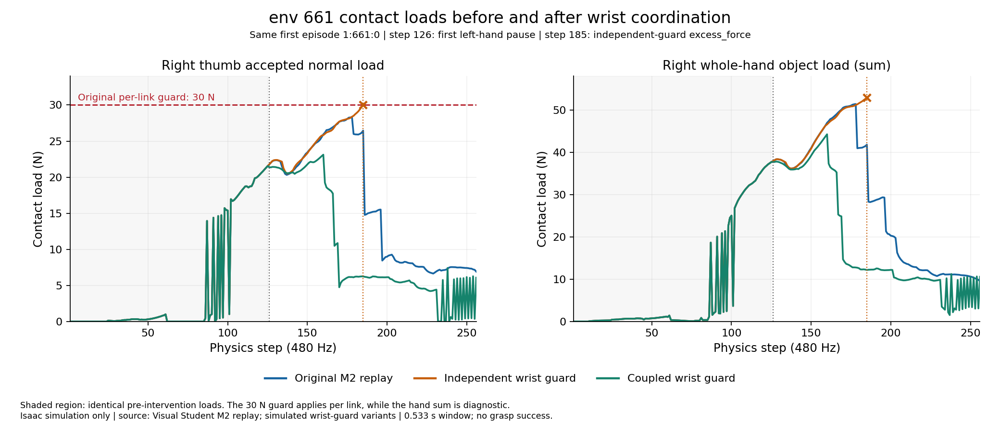

# 第五阶段右 finger12 原生跟踪审计

本次 1024 环境、32 个策略步的独立 M2 原动作重放再次复现两次三指 `joint_limit`。两个环境均由右 `finger12` 实测角度越过原下界保护线触发。508 个存活物理子步的主动关节名称映射全部匹配，指令目标均在原名义限位内。终止时模拟隐式执行器的正向力矩估算均为 +0.200000003 Nm，实测关节仍向下运动。该结果定位了合法目标与实际运动之间的跟踪失败。接触反力、被动联动与腕部运动各自的动力学贡献仍需干预实验识别。

## 原生范围与来源

实验目录为服务器 `/mnt/mydisk/xk/dh116/runs/stage5_physical_mapping_20261108T0840Z/t1_joint_audit02`，冻结源码位于同级 `t1_joint_audit02_source`，进程退出码为 0。重放的 Actor 原始动作来自第三阶段 M2 的已保存 32 步采样。物理初态合并 SHA-256 为 `f41f42a5ca0f95c539a6dcc275adf2b9cbda69861bbe08119f7937dfd65975d4`，与第四阶段原动作回放一致。

`joint_tracking_480hz.jsonl` SHA-256 为 `691a7a5f5bc2748093306cc5aae0f27dcbfbcc0b2fe03643716335c7feed470a`。其中 env 799 有 256 条，env 932 有 252 条。两个回合各保留一条最终 terminal，记录绑定原始 env、episode_uid、policy_step、physics_step 和仿真时间。env 932 的后续 4 个 no-op 位于独立 `joint_replay.jsonl`，审计写入器保留最终有效样本，跳过关闭回合的 no-op。两个启动目录中的较早 `t1_joint_audit` 只遇到复制时间戳权限错误，未启动原生物理，验证次数为 0。

## 最终有效子步

下界为 0.007912623 rad，容差 0.020000 rad，下界保护线为 −0.012087377 rad。物理指令顺序为原 24D 合同的右 `finger12` 索引 7。实际 articulation DOF 通过真实 joint_names 定位为 11。

| env / episode_uid | policy step | physics step | 时间 s | 原始 Actor 索引 1 / 物理索引 7 | 提交 float32 目标 rad | 实测 q rad | 实测 qdot rad/s | 目标−实测 rad |
|---|---:|---:|---:|---:|---:|---:|---:|---:|
| 932 / `1:932:0` | 32799 | 252 | 0.562500029 | −0.254340 | 0.039643493 | −0.012651443 | −0.300013900 | 0.052294935 |
| 799 / `1:799:0` | 32799 | 256 | 0.570833363 | −0.267491 | 0.042210873 | −0.013072879 | −0.300022990 | 0.055283752 |

逆变换前后完整 24D、每手全部 q/qd、完整主动目标、被动联动残差、腕部指令和模拟估算力矩均保留于同一行。Actor 索引 1 经 M2 交换后进入右手物理索引 7，方向保持原合同正负号。env 799 原始 Actor 索引 11 的 −1.065073 经裁剪后进入左手物理索引 5，和右 `finger12` 属于不同维度。

这次采集使用审计 schema v1，字段 `sdk_target_rad` 实际保存的是积分器 float64 的 `world.commands`。对独立回放日志中同一提交表达式产生的 float32 目标逐行核对，508/508 条均严格满足 `float32(world.commands)==提交目标`，最大差为 1.85780814e−9 rad。表中提交值采用 float32，误差分位数使用原始双精度目标。后续 schema v2 直接记录 `hand.data.joint_pos_target`，同时保留积分目标及来源标记。若接口缺失，仅将 float32 重构值标注为重构，不能冒充 native readback。原始 v1 证据与冻结源码均保留。

## 同环境完整轨迹统计

| 环境 | qdot 绝对值 P50 / P90 / P95 / max rad/s | 跟踪误差绝对值 P50 / P90 / P95 / max rad | 拇指 follower 残差绝对值 P50 / P90 / P95 / max rad |
|---:|---|---|---|
| 932 | 0.090204 / 0.300010 / 0.391827 / 0.500841 | 0.010176 / 0.040161 / 0.044981 / 0.052295 | 0.005396 / 0.013733 / 0.014327 / 0.018133 |
| 799 | 0.110386 / 0.295051 / 0.300009 / 0.488142 | 0.019335 / 0.049250 / 0.052791 / 0.055284 | 0.004946 / 0.011968 / 0.014509 / 0.018505 |

follower 指真实运行时 mimic 配置中的 `finger13`，按 `q_follower−ratio*q_master−offset` 计算。终止前的残差均低于原 0.02 rad mimic 阈值，无法把它解释为已证明的独立终止原因。完整 JSON 分析保存两个回合的末 8 个子步和各峰值对应的同环境样本。

| 环境与终止物理步 | 右 thumb 指腹有效载荷 N | 该步接受的法向冲量 Ns | 右 finger12 隐式执行器力矩估算 Nm | 拇指 follower 残差 rad |
|---|---:|---:|---:|---:|
| 932 @252 | 2.432588 | 0.005067892 | +0.200000003 | 0.018133115 |
| 799 @256 | 6.415095 | 0.013364782 | +0.200000003 | 0.018504590 |

接触冲量由该物理步原生 `get_contact_data(dt=physics_dt)` 的指腹接受载荷乘回同一 1/480 s 得到，保留了公式和来源。全接触原始 solver impulse 未额外读取，不能把接受指腹冲量当作全手总冲量。力矩来自 Isaac `hand.data.applied_torque` 的隐式执行器模型估算。真实硬件力矩和实际 solver drive torque 均未知。

env 799 物理步 255 到 256 的右拇指载荷由 0.086257 N 升至 6.415095 N，q 从 −0.011577938 rad 降到 −0.013072879 rad。env 932 在步 245–252 始终有约 2.39–2.76 N 的右拇指载荷，q 持续下行，不能只凭一次载荷尖峰解释所有越限。两个环境最后一步均在正向驱动力矩估算已达约 +0.2 Nm 时继续下行。该观测支持继续检查接触与腕部驱动构成的运动冲突，尚不能定量分离接触反力和被动机构作用。

## 被动 finger13 先到下限附近的顺序

从每个物理样本的实际 joint_names、full q 和独立回放原生 limits 对齐，右 `finger13` 是 SDK 索引 16，原名义范围为 `[0, 0.9012642503]` rad。它在两个回合开始时约为 0.02118 rad。以下用距下限 1e−6 rad 作为离线数值邻域，仅描述读数，不改变物理保护。拇指载荷表采用超过 0.05 N 的首次有效指腹载荷，env 932 在前一物理步 62 还有 1.81e−14 N 的正值，单独保存在 JSON 的首次正值事件中。

| 环境 | 首次拇指载荷 >0.05 N | 首次 finger13 在下限数值邻域 | 当时 finger12 rad | finger12 首次低于名义下限 | finger12 首次越过保护线 |
|---:|---|---|---:|---|---|
| 799 | 步 9，0.056250003 s，0.103939 N | 步 146，0.341666684 s | 0.007031641 | 步 146，0.341666684 s | 步 256，0.570833363 s |
| 932 | 步 63，0.168750009 s，0.325010 N | 步 167，0.385416687 s | 0.024406394 | 步 209，0.472916691 s | 步 252，0.562500029 s |

env 799 从步 146 至终止的 111 个子步，finger13 距 0 的最大绝对值为 2.75933e−7 rad。env 932 从步 167 至终止的 86 个子步，最大为 1.43504e−6 rad，主体停留在下限附近。终止时 finger13 分别为 −1.70967e−7 和 −2.79290e−8 rad，与负的仿射目标 −0.018504761 和 −0.018133143 rad 存在约 0.0185/0.0181 rad 残差。残差数值由接近零的实际 follower 位置与继续向下的 master 仿射目标共同构成。

这组顺序与“被动关节停在其下限附近，主动 master 继续发生跟踪偏移”的观测一致。被动约束反力未直接测得，尚不能单凭时序认定其造成主动关节越限。`t1_analysis03_passive_stop.json` 按环境保留完整事件身份、名义界限和终止值，可与后续腕部单因素回放对照。

## 可控的下一步单因素实验

从相同冷重置重放原 24D 指令至第 240 个物理步，保持此后左手全部动作、右手手指与平移逐项一致，仅将右手内禀旋转速度 21–23 置零，保持已经到达的腕部旋转目标。对照组继续原动作。比较同一子步的 SDK 目标、q/qdot、接触冲量、mimic 残差与估算力矩。若这种单因素干预消除原事件且手指目标仍逐项一致，可把右腕旋转作为该动作段的可复现贡献因素。之后可另行中和右腕平移，不能同时中和平移与旋转再宣称唯一根因。所有组沿用原物理和执行器限制。

## 验证命令与当前状态

CPU 命令为 `PYTHONPATH=src /mnt/mydisk/xk/envs/dh116/bin/python -m pytest -p no:cacheprovider -q tests/test_bimanual_joint_tracking_audit.py tests/test_bimanual_contact_moment_audit.py`，14 项通过。新增测试覆盖真实 joint_names 重排、非法映射、非有限读数、terminal/no-op、跨 reset 时钟和 UID 唯一性、native SDK target 优先级及显式 float32 重构、实测 base pose 和接触点来源、纯逆变换与保护后执行动作边界。

原生分析命令为 `python tools/audit_bimanual_joint_tracking.py <run>/joint_tracking_480hz.jsonl --replay <run>/joint_replay.jsonl --output <experiment>/t1_analysis02.json`。输出位于上述实验根目录，输入完整性和 508 条 SDK 目标交叉核对均通过。本次原生动作回放属于故障重现，Student 成功为 0，不能计作抓取能力验证。新物理动作适配器的原生验证和 Teacher 回归由独立阶段报告。

## 接触力矩离线重建接口

后续采集增加同子步实测 `world.roots` base_link pose 和 `effective_pad_points_w` 指腹接触点，各自保存有效性。`tools/audit_bimanual_joint_tracking.py --asset <冻结USD> --asset-sha256 <实际SHA>` 以该回合实测全关节 q 和 base pose 调用真实右手 USD FK，获得 finger12 的世界轴和轴原点，再计算轴向投影 `axis·((point−origin)×force_on_hand)`。只有位于 finger12 下游的实际接受指腹参与求和。

该值是逐指腹法向力加权接触中心与法向合力所构成的近似力矩。指腹内法向变化可以产生未恢复的局部力偶。摩擦、被拒接触、被动联动约束反力和实际 solver/电机力矩均保留未知，不能把重建值直接当成总外力矩。原 T1 v1 数据缺少实测 base pose 与接触中心，接口对此返回未记录，禁止回算为零。三个纯数组测试仅验证符号、祖先筛选和缺失证据处理，原生力矩结论须由后续独立回放产生。

## 实测跟踪保护的独立短回放

后续 `t1_tracking_guard` 仍为同一 1024 环境、32 策略步的原 M2 动作重放，只在原生跟踪或联动误差达到准入阈值时撤销该手的腕部平移与旋转请求，并用当前实测位姿取消已排队的腕部目标。原手指动作与控制路径继续执行。该实验性控制器的阈值为主动跟踪误差 0.03 rad、原 `severe_coupling_rad` 0.012 rad，属于提前运动准入。原关节、mimic 和载荷终止保护均保持原值。

初态 SHA 与源 Actor 动作 SHA 和原 T1 完全相同。共同的 508 个子步中，Actor 原始 24D、物理手指 12D 请求及右 finger12 的 float32 提交目标逐项相等，最大差均为 0。guard JSONL SHA-256 为 `3fd87915a4a677ed3289cd8e17f35cd354e1b4970d76188de6381690c5ff93b9`，记录 513 条，其中原两环境各 256 条，首轮捕获 env 661 的一条终止。后续独立完整追踪见下节。

该已冻结 guard 数据采用 schema v2，其中 `action_after_inverse24` 当时保存的是保护后实际物理请求，无法作为独立记录的纯逆变换边界。未投影的 M2 逆变换可以由原始 Actor 和原合同按代数重建，必须注明其重建性质。后续 schema v3 分别保存 `action_after_inverse24` 的纯逆变换和 `executed_physical_action24` 的实际投影后请求，速度与腕部诊断均由后者派生。旧数据的比较器按其历史含义读取执行值，原始文件及冻结源码均保留。

| 环境 | 首次右腕 pause | 前一子步主动最大跟踪误差 rad | 前一子步最大 mimic 残差 rad | 右腕 pause 子步数 | 原终止时刻的 guard q12 rad / 原 q12 rad | 256 步末 guard q12 rad |
|---:|---:|---:|---:|---:|---|---:|
| 799 | 141 | 0.030763 | 0.001576 | 85/256 | 0.006939 / −0.013073 @256 | 0.006939 |
| 932 | 156 | 0.014383 | 0.012481 | 35/256 | 0.010316 / −0.012651 @252 | 0.010840 |

env 799 的首次 pause 由主动跟踪误差越过准入线触发，env 932 先由 mimic 残差越过准入线触发。保护按每次实际读数决定，未永久冻结手指。env 932 左手在步 250 也发生 pause，前一步 mimic 残差为 0.012174 rad，因此此回合后段不能把全部变化单独归因于右腕。

原两次 joint_limit 在这段窗口均未再次发生。全 1024 环境的结果由原先两次 joint_limit 变为 0 次 joint_limit、1 次新的 excess_force，不能据此宣称全局修复。新终止为 env 661、episode_uid `1:661:0`、policy_step 32791、physics_step 185、时间 0.422916689 s。右 finger12 目标 0.041471902 rad、实测 0.041635089 rad，跟踪差 −0.000163186 rad。左右全手物体接触载荷分别为 0.666861 N 与 52.895677 N，右拇指与食指有效载荷分别为 30.014557 N 与 22.869897 N。终止时左手 pause 为真，右手为假。首轮单样本证据未覆盖过载形成过程，因此追加完整 first-episode 对照。

基于冻结右手 USD SHA-256 `37ff2a3a724778696f96732f713c0b55c01cc96de0f1c35d4c7e8a7fd7532f71` 的离线 FK，guard 回放内 env 799 的接受指腹法向力矩近似最小值为 −0.515680 Nm，末步为 −0.362525 Nm；env 932 对应为 −0.195259 与 −0.104915 Nm。两者末步隐式执行器正向力矩估算约 +0.2 Nm。法向矩的负号与正向 drive estimate 相反，提供了接触反向作用的可复核证据；由于未包含摩擦、被动反力、被拒接触与实际驱动力矩，无法用两值之差关闭完整动力学平衡。env 661 的单步法向矩近似为 −1.324304 Nm，同样只覆盖其拇指接受法向接触。

离线分析输出位于实验根目录 `t1_tracking_guard_analysis02.json`，由 `DH116_PYTHON=/mnt/mydisk/xk/envs/dh116/bin/python bash scripts/python.sh tools/audit_bimanual_joint_tracking.py <guard>/joint_tracking_480hz.jsonl --replay <guard>/joint_replay.jsonl --baseline <original>/joint_tracking_480hz.jsonl --asset <冻结右手USD> --asset-sha256 37ff2a3a724778696f96732f713c0b55c01cc96de0f1c35d4c7e8a7fd7532f71 --output <新分析JSON>` 生成。该命令只读取 USD、数组和 JSONL，未创建 SimulationApp。短回放缺少合格抓取与保持证据，属于跟踪保护的局部诊断结果。

## schema v3 完整前史与双手共同暂停对照

新增三个独立原生目录 `t1_recorded_full_boundary`、`t1_tracking_guard_trace661` 和 `t1_tracking_guard_coupled`，均监控 env 661、799、932，完整保留各自第一物理回合。它们使用同一物理初态 SHA `f41f42a5ca0f95c539a6dcc275adf2b9cbda69861bbe08119f7937dfd65975d4` 和同一 Actor 动作 tape SHA `e5984cb6c27b417177fb1f647c9b1515bcbb8872a66a5e4456a8a91fea69d02b`。三次均正常退出。源文件与原始数据均按各次启动快照保留。

v3 原动作回放与 v1 原动作回放的原两环境共 508 个子步，全部测得 full q、原始 Actor 和两手 SDK 主动目标逐项相同，最大差均为 0。独立暂停与共同暂停分别对原样组的共同首回合窗口，以及共同暂停对独立暂停的共同窗口内，原始 Actor、实际手指 12D 请求、两手六主动关节 SDK 目标也均逐项相等。腕部投影是这些对照中被改变的控制行为。

env 661 前 125 个物理子步的全部实测 full q、两手 base pose 和手物载荷逐项一致，最大差均为 0。独立暂停在步 126 首先暂停左腕，前一步左手主动最大跟踪差为 0.007465 rad、mimic 残差为 0.012062 rad。右手当时最大跟踪差仅 0.001448 rad、mimic 残差 3.80e−7 rad，独立逻辑始终允许右腕继续。共同暂停逻辑在同一触发时刻一起暂停两只腕部，随后仍随真实状态恢复或再次暂停，两组原手指请求继续执行。

| env 661，在同一物理步 185 | 原样 M2 | 每手独立暂停 | 双手共同暂停 |
|---|---:|---:|---:|
| 右拇指有效载荷 N | 26.450170 | 30.014557 | 6.252856 |
| 右全手物体接触载荷 N | 41.799224 | 52.895677 | 12.164623 |
| 左全手物体接触载荷 N | 0.723276 | 0.666861 | 1.130696 |
| 右 finger12 实测 q rad | 0.042060938 | 0.041635089 | 0.027341865 |
| 右 finger12 目标−实测 rad | −0.000589035 | −0.000163186 | 0.014130037 |
| 右拇指接受法向力矩近似 Nm | −1.163413 | −1.324304 | −0.284692 |
| 此步终止 | 无 | `excess_force` | 无 |

原终止判据为单个 object link 的载荷大于 30 N，独立暂停的右拇指 30.014557 N 穿过该线。全手 52.895677 N 是合计诊断值，不能用它替换单 link 的终止判据。共同暂停组 env 661 的右拇指全窗口最高为 23.115844 N，发生在步 160。因只有腕部处理不同，这个固定动作 tape、固定初态实验支持独立左腕暂停而右腕继续运动对这次新增过载有实际贡献。该贡献仅适用于本次模拟轨迹，无法据此认定全部过载的唯一机制。

| 原故障样本 | 原样实测 q12 rad | 独立暂停实测 q12 rad | 共同暂停实测 q12 rad |
|---|---:|---:|---:|
| env 799，步 256 | −0.013072879 | 0.006939076 | 0.006926654 |
| env 932，步 252 | −0.012651443 | 0.010315994 | 0.010931968 |

共同暂停的 env 799、932 首次暂停均发生在原触发步 141、156，伙伴手的前一步误差仍低于各自准入线。env 661、799、932 各自两手共同暂停了 60、45、23 个子步。0.533333 s 短窗口结束时三者的右 finger12 q 分别为 0.011399080、0.006926654、0.013081053 rad。env 799 仍低于原名义下限但高于原保护线，不能将它描述为已恢复理想跟踪。

全 1024 环境在原样组出现两次 joint_limit，在独立暂停组出现一次 excess_force，在共同暂停组这 256 个物理子步内没有终止。该窗口只有 32 次 60 Hz 控制步、0.533333 s，不是 1024 个完成回合，也未覆盖 5 秒合格 Hold。这个结果证明已观察故障在短窗中可受腕部协同处理影响，尚不足以认定 Student 抓取成功或关节跟踪全局修复。

三份 v3 原始 JSONL 的 SHA-256 分别为原样 `1191f5193284378293a66cbbc3fcf38d55d7a275000e5e6adbf508b55edda5ce`、独立暂停 `0067e7776abd7f2147cb193d99ca1e3faa70cbcd5040ea55efacd9c27f2307a1`、共同暂停 `c97624377b4083cfd883e45604fbf8b3e44b9c8fa2b8ec701dea3584114b8f10`。分析件位于同一实验根目录的 `t1_recorded_boundary_compatibility01.json`、`t1_guard_trace661_analysis03.json`、`t1_guard_coupled_analysis02.json` 与 `t1_coupled_vs_independent01.json`。命令沿用上述离线分析接口，可追加 `--at-step 185 --at-step 252 --at-step 256` 保存同一物理时刻的完整具名比较样本。

### 同环境原生轨迹图



每个子图只使用标注的同一环境和首回合，曲线在该组首次 terminal 处终止。黑色 SDK 目标线仅在三组均有有效样本的共同窗口内、逐项一致性验证通过后绘制；env 932 的黑线止于步 252，不将原样 terminal 后的其他两组目标称为三组相同。实际角度与目标相差并不是目标越过下界。灰线为名义下界，红线为保留原容差后的原保护线。原样 env 799、932 的关节越限点分别标以叉号；共同暂停后的 env 799 在窗口末仍略低于名义下界，不能据图宣称理想跟踪已经恢复。



阴影区为三组逐项一致的前 125 个物理子步，竖线分别标出步 126 首次左腕暂停和步 185 独立暂停组的 `excess_force`。30 N 红线只出现在右拇指单 link 载荷图；右全手是合计诊断，未给它套用单 link 保护线。独立暂停组在首次 terminal 截断，不将后续 no-op 当作有效接触数据。

两图均来自 **Visual Student M2 已保存动作的 Isaac 原生回放**，腕部保护干预读取仿真特权状态；不是 Teacher/MPC 成功轨迹、不是硬件测量。256 个 480 Hz 子步只覆盖 0.533333 s，三组均没有合格抓取成功。绘图不改变控制器、奖励和物理参数。

可使用已安装的 Matplotlib 复现，`--output-dir` 必须是新的派生目录，已有图片不会被覆盖：

```bash
/mnt/mydisk/xk/envs/dh116/bin/python tools/plot_stage5_joint_tracking.py \
  ../t1_recorded_full_boundary/joint_tracking_480hz.jsonl \
  ../t1_tracking_guard_trace661/joint_tracking_480hz.jsonl \
  ../t1_tracking_guard_coupled/joint_tracking_480hz.jsonl \
  --output-dir ../figures01
```

脚本逐项校验共同 SDK 目标、env 661 的共同载荷前缀、首回合身份与单调物理时钟，再绘图。PNG 的 `Description` 元数据保存三份输入的完整绝对路径、SHA-256 与数据分类；图像是可再生成的报告派生件，原始 JSONL 不随图上传。

## 第 240 物理步之后的单因素请求中和

随后独立运行 `t1_rotation_late` 和 `t1_translation_late`，均为同一 1024 环境、32 个策略步的有限回放，退出码均为 0。前 240 个物理子步逐项执行原动作。从第 241 步起，前者仅将右手内禀旋转请求索引 21–23 置零，后者仅将右手世界平移请求索引 15–17 置零。它们没有主动取消先前已排队的位姿目标。

两组对 env 799 与 932 的前 240 个子步，已记录的左右完整 q/qd、实际 base pose、手物接触载荷与 v3 原样回放逐项相同，最大差均为 0。初始物理状态与源动作 tape SHA 均与前述原样回放相同。完整物体中间位姿在这份关节审计中未单列，前缀一致性结论限定于上述实际记录字段。第 241 步之后被中和的三维请求各自最大绝对值均为 0，左右手手指请求及 SDK 主动目标保持原路径。

| 动作组 | 全 1024 环境短窗终止 | env 799 步 256 的 q12 rad | env 932 首越限物理步 / q12 rad |
|---|---|---:|---|
| 原样 | joint_limit 2 次 | −0.013072879，已终止 | 252 / −0.012651443 |
| 240 步后仅中和右旋转 | joint_limit 1 次 | −0.011409809，窗口末未终止 | 252 / −0.012451859 |
| 240 步后仅中和右平移 | joint_limit 1 次 | −0.011877710，窗口末未终止 | 253 / −0.012482147 |

两种中和都使 env 799 在这 256 步内避免越过原保护线，但其实际关节角仍低于名义下限。env 932 仍发生越限，平移组只推迟一个物理子步。两个结果都没有提供长期跟踪恢复或合格抓取证据。

右旋转中和组从步 240 到最后有效样本，已记录 SDK 内禀 XYZ 目标变化为精确零。实际 base 姿态仍继续变化，env 799 为 0.001910 rad，env 932 为 0.002289 rad。说明请求速度置零后，已有目标跟踪和物理动力学仍在推进，不能把这个实验解释为瞬间锁定实际手腕姿态。

右平移中和组的实际 base 从步 240 到最后有效样本仍发生位移，env 799 的 XYZ 变化为 `[−0.013351, 0.038147, −0.015885]` mm，env 932 为 `[−0.034332, −0.005722, 0.013292]` mm。该旧捕获没有单独记录 SDK root 平移目标，目标是否在各子步被其他原生约束改写保持未记录。它只证明未来的平移速度请求被中和，同时实际手腕仍有运动，无法据此排除腕部平移对跟踪偏差的贡献。

本次单因素结果支持腕部运动请求会影响同一接触轨迹中的 master 跟踪偏差。被动 follower 下限反力、接触摩擦与实际 solver drive torque 仍未完整测得，因此物理贡献分解尚未闭合。第 240 步才开始的短窗干预与从早期误差准入开始取消排队目标的双手保护具有不同执行范围，结果须各自保留。

关节日志 SHA-256 分别为旋转组 `33e8e2878f51a1c71275e2f7e844352efd49fdf418bda982f84f597766130077`、平移组 `261a126345dab9b7a6cbb005a73ce7fd6a3e3b1af4f96f99dfb136cc1e73297a`。同根目录下 `t1_rotation_late_analysis01.json`、`t1_translation_late_analysis01.json` 保存事件与法向矩诊断，`t1_late_physical_prefix01.json` 保存前缀逐字段零差及实际位姿/SDK 旋转目标变化。关节分析 CLI 使用原 v1 两环境日志作为共同身份参考，v1 与 v3 的 508 个样本兼容性已独立核实。所有原始目录和失败证据保留。
