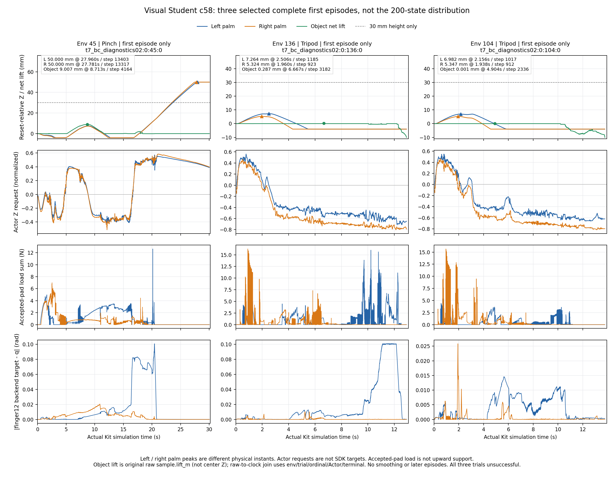

# 第五阶段补充：视觉 Student 原生执行链与首终止审计

本报告于北京时间2026-11-09收口，实验及审计记录使用UTC时间。基准仍为`3f7fd69073ab9060f1932dba74d6dcb13104c6a6`，分支仍为`codex/dh116-lift-repair-20261106`。本次诊断复测已自然退出0；所有原生作业结束后GPU3无计算进程，未启动新的PPO。

**结论：物理映射和日志证据得到补齐，但视觉抓取修复尚未通过。** 原路径及Adapter路径的二指Teacher/MPC各4/4通过原生判据；三指Teacher仍0/4。独立二指BC模型在二指、三指各100个初态上均0成功，同初态诊断复测没有改变这一结果。Teacher、离线BC拟合和Student原生评估分别报告，不合并成功率。

## 冻结实验与样本边界

证据总目录为服务器`/mnt/mydisk/xk/dh116/runs/stage5_physical_mapping_20261108T0840Z`，下文记作`R`。

- 首轮标准评估：`R/t7_bc_validation01`；诊断复测：`R/t7_bc_diagnostics02`。两者有独立输出和冻结源码，均1800个60Hz控制步、每步8个480Hz物理子步。
- 同一只读V4模型`pinch_bc_bound_v4.pt`，SHA `c58f9cf0718d36cd9feec181c9180a9657e97b54d6fa8e99ce1b3f16244f6d97`；同一seed116507及200初态manifest，SHA `28197144e00ca71e25a051934219744e27466cc21e4684a1f76e5c015b59b511`。这是重复观察同200个初态，不是400个独立初态。
- 两次评估间无BC/PPO更新、调参或验证集选模。本次BC仅有二指专家标签；源第1024轮PPO曾混合训练两抓法。三指行是诊断，不能称三指专家迁移。
- 新增诊断默认关闭；本次显式开启`--vision-evaluation-physics-audit`，不改变控制、奖励、reset、SDK动作语义或物理参数。M0仍默认，M2未接入该路径；3844D Actor、371D Critic、24D动作及Tanh合同保留。
- 当前物体仍为原刚性圆柱代理，不是已验证的柔性线缆或真实双DH116。所有载荷/力矩均注明仿真来源，未追加未确认的硬件反馈输入。

## 每抓法100例结果

| 抓法 | 原生评估成功 | 净Lift P50 / P90 / P95 / max (mm) | 达30mm | 合格Hold最大(s) | 新复测首终止原因 |
|---|---:|---|---:|---:|---|
| 二指 | 0/100 | 5.963853 / 14.627709 / 17.124066 / 25.235939 | 0% | 0 | excess_force 16；joint_limit 18；object_dropped 51；timeout 15 |
| 三指 | 0/100 | 0.001133 / 0.276490 / 0.451067 / 0.651073 | 0% | 0 | excess_force 40；joint_limit 7；object_dropped 53 |

失败码取本次480Hz实际首terminal及冻结源码枚举，不按时长猜测；旧标准评估没有保存失败码，不回填原件。`joint_limit`标签本身也不能认定全部来自右finger12。

双侧合格对向接触时间率分别3.490306% / 0.004984%。二指17个trial建立可用接触锚，最大接触锚滑移1.246515 mm，18.904167 s适用窗口的测量覆盖100%；其余83个二指和全部三指trial为NA，不能补零。此接触诊断锚与原生5s Hold窗口漂移不同，均没有合格Hold。隐式执行器仿真估算力矩饱和率6.526028% / 15.434577%，不是硬件力矩测量。

## 完整480Hz、60Hz及终止保护

记录器保存1800个policy batch、450个关闭NPZ块，共2,880,000个诊断行和2183个episode terminal。**正式评估仅取200个首episode、1,353,010条first-live物理记录及200个首terminal**；额外1983个后续terminal不计评估、独立初态或成功数。均值和峰值不得混入后续episode/no-op。

独立审计重新校验全部块/策略/终止文件SHA及2183份完整terminal快照，对每份快照与NPZ同一UID的154字段进行canonical核验：14个身份/元数据数组字段、35组数值数组字段及105个available/finite/source_valid标志字段，不是154项独立物理测量。实际结果：

- 物理步连续，SDK时间戳单调；实测时间间隔为0.0020833334419876337 s，保留原值，不改写为名义1/480。
- `env_id / episode_uid / policy_step / physics_step / timestamp`、实际policy提交时刻、物理保持的Actor24逐项对应；UID/动作/终止跨流联结错误为0。
- 首terminal完整快照保留，后续no-op无覆盖；2183个terminal UID唯一，全部200个首trial各恰有一个终止。
- 原conditional流仍没有显式物理时钟。它与新诊断通过相同env/trial顺序、first-live序号、Actor24和terminal逐行精确联结；时间来自独立诊断，不冒充旧raw本身已记录时间。
- 原五项证据证书与可选诊断分开核验。`conditional_telemetry_complete=true`；旧严格`telemetry_complete/validation_complete/native_validation_complete`仍为false，不为晋级而改标志。

## SDK后端、缓存与实际运动分开

1,353,010条首有效样本中，两手实际速度、具名17DOF类型、真PhysX后端目标及IsaacLab命令缓存的available/finite/source_valid覆盖均100%。真后端由`root_physx_view.get_dof_position_targets()`读取，无缓存fallback；两手backend与cache最大差均0。2个source事件另与实际configuration关节名、同子步native DofTypes及单位交叉核验：三个平移轴为m，其余旋转DOF为rad。

完整17DOF后端目标包含腕部carriage局部目标及无主动drive的被动关节字段，不能混成17维弧度、world掌位或全部主动跟踪合同。SDK后端=缓存证明该次提交链一致，不等于实测关节到位、接触成立或抓取合格；根位姿、掌心位移、关节q/qd、接触载荷和投影仍独立分析。

旧T1 v1是提交前float64命令，v2/v3及TeacherAudit V1是命令缓存证据，不能倒授本次后端资格。另一个独立T1 v4短窗已确认旧M2的两个finger12事件在合法后端目标下仍实际越界；它与本次BC模型/原生成功分开，详见[关节审计](2026-11-08-stage5-joint-tracking.md)。

## 与首轮评估的实际配对核验

200/200实际reset读回状态SHA相同，200/200首Actor24逐位相同。原始3844D初始观测197/200逐位相同；env133、181、197（三指）有差异，最大绝对值分别1、1、0.00998687744。差异原样保存，不臆测成相机、TF32或记录器的唯一原因。

两个run的每trial已保存11项结果指标均200/200数值相同，包括成功、Lift、Hold、滑移、接触时长、样本数、观测时长、估算力矩饱和及动作变化量。这些是具体字段的核验，不扩大为整个状态/像素/执行轨迹逐位相同或任意GPU运行完全确定。

## 逐手动作与实际位移

下表的掌位统计是100个首episode各自的实测reset-relative世界Z峰值再取分位数；不是100个环境拼接的轨迹。Z动作均值/标准差仅使用唯一60Hz首有效policy样本，长短回合产生不同样本权重，不是480Hz重复计数或每trial等权均值。

| 抓法/手 | 掌峰值P50 / P90 / P95 / max (mm) | 末Z位移P50(mm) | Actor Z mean / std | finger12每trial最大跟踪绝对误差P50 / P95 / 全局max (rad) |
|---|---|---:|---|---|
| 二指左 | 5.727187 / 23.581398 / 36.491850 / 50.000072 | 0.930130 | -0.145471 / 0.299809 | 0.014883 / 0.100625 / 0.100627 |
| 二指右 | 6.066173 / 23.831540 / 35.579744 / 50.000072 | 0.845864 | -0.181460 / 0.319847 | 0.022673 / 0.067915 / 0.102433 |
| 三指左 | 6.798506 / 7.053763 / 7.123414 / 7.263601 | -3.999949 | -0.311560 / 0.357315 | 0.014710 / 0.100631 / 0.100765 |
| 三指右 | 4.962146 / 5.180150 / 5.255637 / 5.346656 | -3.984734 | -0.461273 / 0.387398 | 0.009265 / 0.020156 / 0.092671 |

Actor请求与控制器原始24D逐项最大差0；两手在同一world chart中的pre/post目标投影率均0。由实际执行表达式重建的control-frame SDK掌目标与投影目标最大差8.881784197001252e−16 m，区别于另行读取的真backend17DOF。实际palms/q/qd继续独立保存。因此本轮不能把右手负向请求解释为该处投影或提交链把正动作反转；这也没有证明策略为何在训练中形成负偏置。

投影0只适用于该采样边界：`pre_projection`已在原XYZ速度norm限制和`constrain_palm_z_movement`之后，policy/target还存在更早的原限幅。它不证明整条链所有速度/transport/contact保护均未触发，也不表示达到50mm时没有原目标边界或运动lag。请求目标字段同样只是原capture阶段的`task.palm_targets`，不是额外插桩得到的最早未限幅目标。

完整24维唯一policy均值/标准差/极值在`analysis03.by_style.{style}.moments.actor_request24_unique60Hz_policy`；二指/三指分别118998/50211个请求。另存`per_trial`逐维饱和率，阈值明确为`abs(action)≥1−1e−6`，24维分子均0。重复480Hz moment在另一字段`actor_request24`，两种population不混用。

按480Hz首有效样本计算的accepted pad平均载荷（N，顺序拇指/食指/中指）为二指左0.526819/0.448463/未启用、右0.385921/0.422840/未启用；三指左0.404638/0.157014/0、右0.148488/0.077880/0.285799。它们不是同一时刻的承载，也不是桌/支架反力或硬件读数；各pad最大值及逐env原始轨迹另存，不能把逐pad最大值相加当合力。

具名主动finger12目标减实测误差与无主动drive的五个被动关节目标差分别统计。被动耦合残差只使用冻结`runtime_mimic`明确authoring的affine合同，不冒充live约束参数、solver反力或唯一越限根因。每手对向接触率的逐trial P50/P90/P95，由保存pad数据重算分别为二指左25.9188/50.6565/54.9977%、右14.0508/36.5596/45.5743%；三指左4.0778/6.4485/9.0510%、右2.7392/21.3523/22.9769%。该重算未独立保存`effective_pad_bad_env`，不能替代上文原生双侧资格和成功判据。本次三指左中指accepted载荷均值/峰值均0，只表示未记录到被接受的该pad承载，不推断绝对无任何碰撞或唯一原因。

## 峰值身份与同环境完整轨迹

| 掌峰值 | env / episode_uid | policy / physics step | SDK时间(s) | 当刻物体净Lift(mm) |
|---|---|---|---:|---:|
| 二指左50.000072 mm | 45 / `t7_bc_diagnostics02:0:45:0` | 1675 / 13403 | 27.960418125 | -0.000008676 |
| 二指右50.000072 mm | 45 / `t7_bc_diagnostics02:0:45:0` | 1664 / 13317 | 27.781251449 | 0.000029219 |
| 三指左7.263601 mm | 136 / `t7_bc_diagnostics02:0:136:0` | 148 / 1185 | 2.506250131 | -0.000060890 |
| 三指右5.346656 mm | 104 / `t7_bc_diagnostics02:0:104:0` | 113 / 912 | 1.937500101 | -0.004811211 |

四个时刻均无双侧合格对向接触、Hold为0、滑移无锚为NA。二指两手最高值来自同env但不同时刻，三指两峰来自不同env；不能拼成同一双手轨迹。尤其掌上移50 mm而物体当刻仍接近原高度，证明“掌移动更高”不能替代有效抓取。

图仅展示env45、136、104三个选中峰值见证，不代表200例分布。物体净Lift直接取原raw `sample.lift_m`，不以中心Z代替；原conditional时钟缺失，时间由已核对的独立诊断提供。三个完整首episode共27181行逐项通过身份、Actor和terminal联结，无平滑或后续episode。第三行载荷不是向上承托力；最后一行为具名主动finger12的真backend目标减实测q的绝对值。

绘图源`R/t7_student_same_env_plot02.py`的SHA为`d6901d6aa4255ce8bde163ca2f025899283308976c0c4e00539c61c6b695f991`，图SHA为`497f10434d0ed878c84b9137e2fb7e1ce2f1bc744c49654f6e15e4683b9ee221`；完整输入/联结来源见下方provenance，不修改实验原件。

`R/t7_palm_peak_cases03/`分别保存env45、136、104的同env完整首episode双手轨迹，含Actor/controller24、实际/目标掌位与速度、投影、backend/cache/q/qd17、各pad载荷/有效性及来源mask。独立400个逐trial/手峰值与原conditional wire/Lift/力矩/动作关联后，env/UID/step/time/height/Actor逐项一致。两份审计序号起点不同（0/1 base）明确转换，不改原件。

| 同env完整CSV | SHA256 |
|---|---|
| `env_45_first_trial.csv` | `6b1954207817464d0d3682bbb57def75162c4c808c80aee91f9b7ba0856f6714` |
| `env_136_first_trial.csv` | `688b89d7a5b147a6f2d83a2fd5466dec2fbb8b1ecec75997d8a788037768adf7` |
| `env_104_first_trial.csv` | `b48d5b69779c4ebd62300b6d2d9b657c68836e243592b33c62e81d40b87fdfca` |

## 证据、CPU检查与仍未满足的门槛

| 派生证据（均在R） | SHA256 |
|---|---|
| `t7_native_diagnostics_audit02.json` | `b96fe33e7b823c4e4f6a9273b047e058390ed4181db98f362684411ef4e5bfaa` |
| 本次 `vision_evaluation_report.json` | `61609d5fe60afd62a10d06924786fd73aed4f978f19f3fa47449c301a641b417` |
| 本次原生certificate | `e10c71d682e6d3ba8c8f207ab45936c4884241fbe62e27cce482711c9b241e44` |
| 本次可选诊断`summary.json` | `cd48c65df81ef655cefd3824a08614bc99d7e08b7352458b6c7f7dfa2a18a3e7` |
| `t7_initial_repeat_comparison02.json` | `3816247fc7e8d56185fb64602b340203834ac50c4396978e76cf7c44dfff0a6a` |
| `t7_per_hand_diagnostics_analysis03.json` | `c20269e68a5a65728b210366d51cd93209eb34502b0c2e8e2d40a0e1ae58f3e0` |
| `t7_per_hand_witness_crosscheck03.json` | `2656cbfb1804ff4a1a6e285b69fb210d3fda3d3b8fc4961e403de059bb168402` |
| `t7_policy_statistics_unique60Hz03.json` | `6b683f438df522a9c30b7458b5039c73e29bb87dbca7283043220951ac8b6f18` |
| `t7_same_env_raw_first_trials02/manifest.json` | `9d2df71f211af47c5346859c09f774164c6832340bd66437de58a05f7fa4c1d2` |
| `t7_student_same_env_plot_provenance02.json` | `13b2e00d6d1de8b2510ffb6dfdf07b7ba5124c68f3182f376e0af48c94c0a2e1` |

最近源码聚焦CPU回归为522 passed、1 skipped、39.46 s、exit0，命令为`bash scripts/python.sh -m pytest`后32个显式测试路径；完整argv、独立basetemp、7份源码前后SHA和`changed_sources=[]`保存在`cpu_stage5_full_targeted_20261108T150338Z_exit.json`。日志SHA `34e9c1805dc9e15056b3c799ba5b13821ac6a7290b4a5d5c9bc37149dba40e2a`。这些不是原生试验数；更早全仓快照仍有113失败和25错误，见[总报告](2026-11-08-stage5-native-validation.md)，不宣称全仓测试通过。

本阶段保留了合法目标下实际跟踪失败、三指失去双侧承托、失败Z3及视觉BC无成功的完整负面证据。小扰动映射正确、二指Teacher4/4及PointNet恢复坐标敏感性，均不能替代Student抓取。移动腕逐指恢复仍缺实际cooked/live碰撞资格，T6只改双腕且未接入逐指FSM；三指没有合格专家，DAgger没有已验证的状态查询专家。因此没有三指BC、DAgger或新PPO，不能绕过T1～T5安全门槛继续堆迭代。

原30mm / 连续5s / 0.5mm标准、物理、材料和执行器限制保持。T5的`ordinary`是手物拒接触，不是桌/支架反力；独立成功窗审计已明确该反力缺测，几何间隙不当成力传感证明，见[Teacher报告](2026-11-08-stage5-teacher-coordination.md)。本次仍未证明可靠三指或视觉Student Lift，PR继续Draft，不合并。
