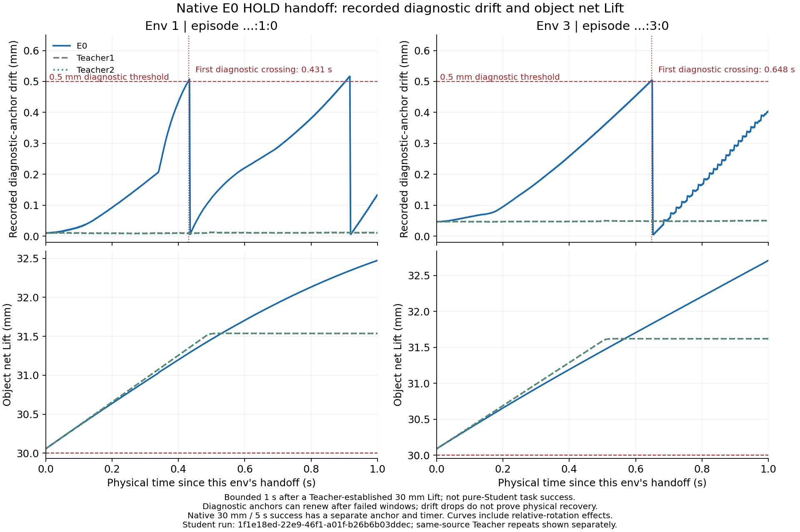

# Stage 7：Teacher 与 Visual Student 首次物理分叉

本记录对应 `codex/dh116-lift-repair-20261106`，基准为 `e643ad6e9521225dd2ec0c0aa9dc97c820a2b3b9`。本记录完成 Stage 7 第一证据单元；后续新 Teacher/MPC 及正式配对资格仍未通过，不是 Teacher 替换证明。M0、原 Teacher、3844D Actor、371D Critic、24D Tanh Gaussian 及原始物理、执行器和 30 mm / 5 s / 0.5 mm 标准保持不变。PR 继续 Draft。

## 0. 结果与执行决策

Stage 7 第一证据单元已完成：E0/B0/B1/B2 的完整来源回合均为 **0/4**，未达 30 mm，合格 Hold 均为 0；两次成功 Teacher 重放各 4/4 单列。64 项冷重置短切换和 64 项六时点后处理全部完成，仍不构成 Student 成功、泛化或新 Teacher 替换证明。

**当前没有可晋级的闭环目标赢家。** 保留 B0 为均匀单步控制组；保留 B1 为事件采样诊断基线、B2 为条件命令损失消融假设，不把任一候选当作已验证主线追加训练。B1/B2 在完整来源安全结果和接管后的原生保持上未显示一致优势，B3/PPO 门禁继续关闭。下一优先级是独立的真实接触测量和 Teacher/MPC 闭环升级；新专家池、DAgger 和 PPO 仍须经过各自原生资格，不能由本次诊断解锁。

这一决策不按离线 MSE、单一峰值、接触闪断数或短窗无 terminal 排名；只适用于当前四来源、同一标称布局，不能推断总体成功率或唯一失败原因。既有二指 Teacher/MPC 成功路径及全部模型保留，三指尚未取得成功专家资格。

## 1. 实验身份和边界

服务器实验根目录记为 `R6=/mnt/mydisk/xk/dh116/runs/stage6_sequence_20261109_v01`。模型、原始轨迹、失败、运行日志和冻结源码保留在独立目录，不加入 Git。

| 名称 | 实际模型 SHA256 | 来源 |
| --- | --- | --- |
| E0 | `c58f9cf0718d36cd9feec181c9180a9657e97b54d6fa8e99ce1b3f16244f6d97` | Stage 5 实际二指 BC 派生 V4 |
| B0 | `02f3d5f983e0315d8a0858699ad8cca2e3d088375826cd31f126179305c8855d` | 均匀采样、单步 BC，实际完成第 3000 次更新 |
| B1 | `26bf92dc127bba9a809361397b5d6b6346d7aa245fec26077c05358597c894fd` | 事件采样、单步 BC，实际完成第 3000 次更新 |
| B2 | `510c31239e7a08e5c58d6408eed77af71a1070690e2f72de2b5df8e5044ba8b8` | 事件采样、条件命令展开，实际完成第 3000 次更新 |

三组 BC 各有 192,000 个有效样本曝光，padding 为 0；只修改 Actor，源 Critic、log_std、原 PPO Adam、计数、LR、RNG 和观测/动作合同保留。选择预定最终更新模型，没有按训练误差挑选模型。

Teacher02 原生二指 4/4、三指 0/4；当前成功监督池只有四个二指来源，含 4698 条视觉记录。原 Teacher 冷重置 tape 重放 01 为 4/4，报告 `133ccd86a7f8377f5a37172a28d9fdaad5d63eeff2c8494b1f6b3892ecd4b5c0`。这些是 Teacher/MPC 结果，不计 Student 成功，也不是额外独立初态。

第二次实际冷重置重放 02 也已自然结束：1175 个控制步、四个首 terminal 均成功、纯 Student 计数 0；新的 execution UUID 为 `2dfcd10c-0012-4c5b-81a6-07cdad6c3994`，与 01 的 `e4668000-6287-4883-8a3f-118d1f6f7708` 不同。报告 `R6/native_e0_replay02/jobs/teacher_replay_E0/stage6_native_report.json` SHA256 为 `32a5b02e3e2f5c33e8b95f99fa528035f2fe7b2ea040c253e09391e1548aedfb`，raw SHA256 为 `0464d4451d6c04266199fee6c671dd9a6f32031b8c5fe820b5dbb1e07bb3c6b3`。两次重复只用于同四个来源的参考范围，不变成八个独立初态。

重放 02 的 reset/相机读回完全一致，296 个 audit 所列原件逐份核 SHA；handoff 证明 `R6/native_e0_replay02/handoff_validation.json` SHA256 为 `204f642c1d30eaafa14d1ae1f548f38dfaeaf82687b36389dc6620ebac2fda36`。先确认子进程退出且全局原生锁释放，再授权新的有限串行分支计划。

来源覆盖另经原始冷 reset 张量只读审计：四个 env 的 q、qd、command、物体/手根 quaternion 和 reference_bottom 均相同。扣除物体中心的场景平移后，手根相对位置与 env 0 的最大差分别为 0、`5.9604645e-8`、`2.3841858e-7`、`2.3841858e-7` m；没有在此步骤做旋转物体坐标的进一步规范化，且物体 quaternion 本已相同。这些结果支持将四来源视为同一标称布局的场景副本，不能称为四种独立设计的物理条件或泛化初态。后文的“四来源/四初态”是原数据身份计数，不是独立场景分布样本数。

覆盖报告 `R6/stage7_source_initial_coverage_v01/coverage.json` SHA256 为 `8a19d360e1241abd9054f7d74bca83fb2cb8334055ba7bae0a276961a6d614af`，绑定原始 cold-reset 文件和 plan37752，输入 SHA 不变、新增 native 次数 0。后续每种抓法 100 个不同初态及新旧 Teacher 资格仍是未完成的独立门禁。

### 滑移字段的来源与成功窗口必须分开

此报告旧进度表沿用原字段名 `slip_m` / fixed-anchor slip；精确含义是 [EvaluationTelemetry](../../../src/go2_pvcnn/control/dh116/tabletop_evaluation_telemetry.py) 在 consume **之前**复制的 prior tracker anchor 所得到的漂移。在当前 vision-student 配置中，tracker 优先为独立 `surface_slip_tracking`，其最低高度为 **3 mm**；原生 `qualified_hold_s` 和 success 则来自另一份 `surface_lift_success`，最低高度仍为 **30 mm**、连续 **5 s**。两者的锚与计时可以不同，不能把 raw `slip_m` 的 0.5 mm crossing 直接称为原生成功窗口同一锚的违规时刻。

[hold_window_step](../../../src/go2_pvcnn/control/dh116/tabletop_lift_hold_window.py) 在一次有效窗口内固定锚；窗口因漂移超 0.5 mm 或物理条件失效而结束后，清空该窗口计时并为下一次尝试建立参考。因此曲线突然回落不证明物体瞬间恢复、手重新抓稳或物理 episode reset。原生成功仍只按原 Task 的成功标志及其独立计时认定，没有修改阈值、物理或旧数据。

该漂移还不是逐指腹摩擦滑动的直接测量：[rod_points_in_hands](../../../src/go2_pvcnn/control/dh116/tabletop_multifinger_monitor.py) 把线缆几何体内的 `(0,−0.2,0)`、`(0,+0.2,0)`、`(0.008,0,0)` m 三个标记变换到左右实际 legacy body-link/wrist 坐标，再取与所选锚的最大欧氏差，包含相对转动的杆长杠杆效应。不能由该值直接得到 per-pad tangential slip speed。源码释义证明分别为 `b91e98fe1b48806dc02c73a449c0a80d89f2d9c192f3065dc42176adaae12208`（anchor scope v02）及 `4a5982cedd8a6e588a0212fa43582d5320ec9934c1fe2a819e8ee3eb27b11a4c`（marker definition v03）；旧数值原件保留，均未新增 native 作业。先前把诊断漂移跨线直接表述为成功窗口滑移违规过于宽泛，此处更正口径。

## 2. 纯 Student 来源回合

实际来源作业位于 `R6/native_sources01/jobs/source_{E0,B0,B1,B2}`。每组使用原四个二指成功来源的相同冷初态、seed 42、8 个物理环境和固定 224×96 RGB-D；只评价 env 0–3，env 4–7 为零动作中性环境。Teacher/MPC 关闭，从真实 reset 到每个环境首 terminal；后续自动 reset 不计入原回合。

| 模型 | 已完成首回合 | 原生成功 | 原生报告 SHA256 | 当前结论 |
| --- | --- | --- | --- | --- |
| E0 | 4/4 | 0/4 | `ce4f5369ef46fd0933dfde85219604ddcdf6fff36ca1230152f4b667cb83dc29` | 3 掉落、1 超力，未复现来源 |
| B0 | 4/4 | 0/4 | `6de690d95d6b13efd38842b3d660ebafa2b824aba99dd3277277fd9e1f68d1d6` | 2 掉落、2 超力，未复现来源 |
| B1 | 4/4 | 0/4 | `5b4da6cc392fd0fe8cde58ea3fa129e7cb4477508c8d3368e9620ca45228ae61` | 2 掉落、1 超力、1 关节越限，未复现来源 |
| B2 | 4/4 | 0/4 | `8b3bd969002f608f3909ef5b9e674864e36b4d95da0edbcfa56ed6da4e3c6aa1` | 2 关节越限、1 超力、1 超时，未复现来源 |

E0 四环境物体峰值依次为 13.461731、16.094807、2.847603、0.310310 mm；B0 为 0.098933、0.078604、0.007701、0.400943 mm；B1 为 4.283587、4.946619、10.983376、9.830318 mm；B2 为 9.448960、12.799211、6.229101、14.752878 mm。四组全部未达 30 mm，合格 Hold 均为 0。峰值来自各自环境，不拼接成同一轨迹；完整 UID、动作、480 Hz 物理记录和首 terminal 以原始作业为准。四个来源例子不能替代每种抓法 100 个独立初态的正式验收。

B2 的实际 run UUID 为 `68b9d257-a5ae-4270-9718-257063d6643f`，episode UID 为 `run_uuid:env_id:0`。env 0/1/2/3 的首 terminal 分别在 policy 1799/581/1001/1043，整组实际执行 1800 步；env 0 按原 480 Hz 物理累计时间触发 timeout，没有修改时间判据或额外放宽时限。

## 3. 相同 Teacher 观测与条件命令比较

真实离线分析：`R6/stage7_divergence_validation/all4_offline_v02/teacher_student_divergence.json`，SHA256 `a114be9286fbcec1b5a3451483b19aae8383302ac81dce7805af8c45243d04c0`。输出端点张量 SHA256 `ca32093b4d23daa13c586dfe3058d26c3a45e0d2db7ad0e483dda0fda8445935`。

使用同一 4698 条 Teacher 预动作观测和真实 `actually_issued_action`，原 Actor 单次 Tanh 确定性推理。先检查 4638 个有效 L16 窗口、593,664 次重叠物理子步的 Teacher 精确目标一致性，最大 float64 误差为 0。Teacher 和每个 Student 各自累计命令，反馈均为同一保存的实测上下文；端点为各窗口最后一个有效物理子步。这不预测未来物理状态或接触力。

| 模型 | 24D 动作 MAE | 非零 Teacher 动作方向一致率 | L16 手指目标 MAE (rad) | L16 掌平移目标 MAE (mm) | L16 腕旋转参数 MAE (rad) |
| --- | ---: | ---: | ---: | ---: | ---: |
| E0 | 0.006048918 | 0.66748 | 0.000323576 | 0.0135843 | 0.000520027 |
| B0 | 0.002553044 | 0.71872 | 0.000095450 | 0.0063069 | 0.000177224 |
| B1 | 0.003114122 | 0.72901 | 0.000142746 | 0.0104351 | 0.000206113 |
| B2 | 0.003054168 | 0.70645 | 0.000137512 | 0.0089158 | 0.000220541 |

Teacher 精确零占 69,894 / 112,752 个动作标量，各模型在这些位置的非零预测另行报告，零值不并入非零动作方向一致率。详细报告保存 24 维和左右 thumb/index、palm XYZ、wrist XYZ 分组的 MAE/P95/max/方向及 START/CONTACT/LIFT_ONSET/HOLD 分层；这些离线事件邻域允许重叠，不是在线控制阶段，也不作为 Actor 输入。

[逐手逐事件明细](2026-11-09-stage7-saved-observation-stats.md) 将四模型 × 四事件 × 左右八个动作分组的 128 行动作统计和 128 行 L16 目标统计列出。L16 端点聚合已与原完成报告的 12 个整体组、48 个事件组核对，离线表格绝对容差为 1e-15；不是物理或成功标准容差。附件 SHA256 为 `1787bd1f75d3c05d4592c144a3afaee8207dca25523b0ee9a6d5f96835fbcc96`，服务器生成 manifest 为 `R6/stage7_saved_observation_report_v01/manifest.json`，SHA256 `d3a3d3e3e36a8d2b1026f1745c9339425b9e9673cb57bfc1d16fcf25715e4197`。这是对既有完成分析的只读汇总，新增原生/训练次数为 0。

上表 palm/rotation 是原 24D 合同的累计命令目标，原控制图中的掌平移对应 base_link/SDK wrist-root 命令图，不是实测 palm-link 抬升。旋转统计是原 seed 内禀 XYZ 参数差，不冒充姿态测地角。真实具名 body 位姿、关节/接触与物体净 Lift 仍以同次原生记录为准。

B0 在这些观测/命令指标上更接近 Teacher，来源任务仍是 0/4。因此这些指标只能描述拟合，不能决定闭环模型晋级，不能据此声称首次差异是失败原因。最终目标决策见第 0 节及第 4 节最终结果，不能由离线误差晋级。

## 4. 短切换协议与首次事件

Stage 7 独立有限驱动为 `scripts/run_dh116_stage7_evaluations.py`，固定 4 模型 × 4 入口 × 4 时长，共 64 个串行作业。每个作业重新冷重置、重放完整 Teacher 前缀，再由 Student 执行 1/4/16/60 个控制步；这是混合控制诊断，不计纯 Student 成功。尚未完成的实验不在本记录中计数。

短窗口正常结束是 `bounded_branch_completed`，不是任务失败。最长 60 步只有 1 s，不能替代原 5 s Hold；无首 terminal 的窗口也不能当成失败 episode。短切换主要比较同状态附近的实际动作/目标、接触、净 Lift 和跟踪的差异及真正发生的失败，不能按这类窗口的原生成功计数给模型排名。

`PRE_CONTACT` 使用实际 post-physics 首次双侧接触之前的控制步，不能用旧预动作 CONTACT 简单减一。实际绑定参考 `R6/stage7_event_reference02.json` SHA256 `d9eb43da8ef087b341d03d7e05627a5c3c83fe4f74a7e07baef53f55eef450af`：首次实际 post 接触为 policy 121，PRE_CONTACT 为 120；原预动作 CONTACT/LIFT 为 env 0 的 122、env 1–3 的 123，HOLD 为 env 0/3 的 875、env 1/2 的 876。初态已接触或没有前一控制步时必须标 NA，不能夹成 0。

当前原始记录中的 CONTACT 与 LIFT_ONSET 恰好同 tick。两标签仍按协议分别冷重置重跑并保留不同 execution UUID，可作为同一切换边界的重复观察；不能把它们称为两种不同物理初态，模型比较也不能不加说明地给该边界双倍独立证据权重。没有为分开标签而改写原事件定义。

事件参考绑定原始数据/上下文/冷 reset/集合报告/实际重放报告和实现字节。新 14 依赖离线 cache 只复用保存观测的前向与条件展开，不复用任何 PhysX 接触状态、物理 reset 或 terminal；旧 13 依赖 cache 不假装兼容。

实际 64 项计划启动前先通过以下 CPU-only 准备；其后的原生进度另列，不能把准备计数当执行计数：

- 源码 `R6/evaluation_source02` 为已通过 142 项检查的 CPU capsule02 的 2862 个文件逐字节复制，每项文件重新核验。
- 计划 `R6/native_stage7_branches01/batch_plan.json`，SHA256 `37752c088076d156205e069cdf9e3fe00ebe758f06e4230eb8dfb8c287a569ea`。
- 准备证明 `preparation_validation.json`，SHA256 `322301f0a63378921d622d1b4e9e6e774d616a4bb9c97448482c8da7b35c66bd`。
- 准备时原四组实际模型/完整来源结果全部绑定，`native_jobs_executed=0`、物理复用/自动重试/PPO 均关闭。TeacherReplay02 已自然结束并核验；新有限驱动获准串行执行，实际完成数量待原生结果写出后另计，不能把计划 64 当作已完成 64。

首次准备脚本因为进程内已导入另一个 CPU 源码目录的 workflow，被原来源检查拒绝，未生成计划、未启动 Isaac；保留该尝试后，使用全新进程和明确选定的 frozen02 导入路径完成准备。没有通过源码 SHA 别名或放宽检查绕过失败。

### 最终 64/64：原生执行、Student 段与后处理

实际有限驱动已自然 exit 0，64 项均为 bounded_branch_completed；最终执行报告 R6/native_stage7_branches01/batch_execution_report.json 的 SHA256 为 282ac3639bff960653a98c0554ad383ba5f36e86ce6ac384204c47d3ffaafef9。独立交接审计 handoff_validation.json 的 SHA256 为 7d05c1b98adb0f249493cb2c1b74c2f8da18dd1f239ac256f67f07a142dedc94：核验 2862 个冻结源码文件、64 个 execution UUID、每项原始 gzip 完整 EOF 和实际 owner/UID/clock 窗口；交接时无原生进程、无锁持有者、无 batch_error。

64 项对应 256 个短窗口，实际 Student 控制步合计 5184、480 Hz 子步 41472；Teacher 前缀子步另为 635392，Student 缺失子步 0。全部窗口正常截断、首 terminal 总数 0，不能据此计算完整任务失败率。它们重复四个原来源，没有增加独立初态；CONTACT/LIFT_ONSET 是同一实际边界的重复观察。

最终 Student 段汇总 R6/stage7_branch_segment_analysis/final_v01/summary.json 的 SHA256 为 656b92368ba62e165fffa0cbafafd0c7854ad0b4cc155457b6ab663dbc007923；默认完整模式核验 525 个输入/代码 SHA before=after。其后完整六时点交叉投影的 SHA256 为 13270507cc48769e8d2fd43061e612b1e162a179baa6af15e947985ef1f5cdbd，全部 64 个登记和 256 行均齐全，新增 native/训练次数为 0。完整聚合数值、带 owner 的事件时序见[64 项短切换附件](2026-11-09-stage7-branch-comparisons.md)；峰值 packet 直接保留 env/source/execution UID、policy/World 步、timestamp 和 raw 行指针；六时点事件 packet 另保留派生 SDK 步及 NPZ 指针，不能把后两项说成 raw-only 峰值中已记录的字段。不同环境峰值不能拼成轨迹。

#### 已执行命令与退出

原生驱动实际于 2026-11-09 07:53:13 UTC 启动，原 session 96407 自然 exit 0；以下为原工具记录中的命令，计划及输出目录保持只读，不在本次汇总重跑：

```text
ssh -o BatchMode=yes -o ConnectTimeout=8 -o ForwardAgent=no xk@172.31.179.148 "cd /mnt/mydisk/xk/dh116/runs/stage6_sequence_20261109_v01 && PYTHONPATH=evaluation_source02/src CUDA_VISIBLE_DEVICES='' OMP_NUM_THREADS=2 /mnt/mydisk/xk/envs/dh116/bin/python evaluation_source02/scripts/run_dh116_stage7_evaluations.py --execute /mnt/mydisk/xk/dh116/runs/stage6_sequence_20261109_v01/native_stage7_branches01/batch_plan.json > /mnt/mydisk/xk/dh116/runs/stage6_sequence_20261109_v01/native_stage7_branches01_execute.log"
```

外层驱动为空 CUDA；真正子 Isaac 的 launch 记录使用 CUDA_VISIBLE_DEVICES=3、DH116_NUM_THREADS=2、原 480 Hz 和 8 环境配置。每项独立源码副本、完整 argv/cwd/env 均保存在 jobs/branch_..._launch.json；第一项 branch_E0_PRE_CONTACT_01_launch.json 的 SHA256 为 b096a3a38de049222e3628adb7e32fc3deaf386412820a5ed282f1e9d4ba6c23。空 CUDA 的驱动/CPU 分析不能当作第二个 Isaac 或无 GPU 的物理实验。

最终两个只读入口实际分别 exit 0；外层还先校验固定分析实现 SHA，再以 runpy/子进程调用下列相同参数。未传 progress，任何未关写原生 outcome 或未登记六时点会拒绝 final：

```bash
CUDA_VISIBLE_DEVICES='' OMP_NUM_THREADS=2 MKL_NUM_THREADS=2 /mnt/mydisk/xk/envs/dh116/bin/python /mnt/mydisk/xk/dh116/runs/stage6_sequence_20261109_v01/stage7_branch_segment_analysis/cpu_capsule02/src/go2_pvcnn/control/dh116/tabletop_vision_stage7_branch_summary.py --plan /mnt/mydisk/xk/dh116/runs/stage6_sequence_20261109_v01/native_stage7_branches01/batch_plan.json --plan-sha256 37752c088076d156205e069cdf9e3fe00ebe758f06e4230eb8dfb8c287a569ea --output /mnt/mydisk/xk/dh116/runs/stage6_sequence_20261109_v01/stage7_branch_segment_analysis/final_v01
CUDA_VISIBLE_DEVICES='' OMP_NUM_THREADS=2 MKL_NUM_THREADS=2 /mnt/mydisk/xk/envs/dh116/bin/python /mnt/mydisk/xk/dh116/runs/stage6_sequence_20261109_v01/project_stage7_branch_tables.py --summary /mnt/mydisk/xk/dh116/runs/stage6_sequence_20261109_v01/stage7_branch_segment_analysis/final_v01/summary.json --summary-sha256 656b92368ba62e165fffa0cbafafd0c7854ad0b4cc155457b6ab663dbc007923 --capsule /mnt/mydisk/xk/dh116/runs/stage6_sequence_20261109_v01/stage7_posthoc_capsule01/capsule.json --analysis-root /mnt/mydisk/xk/dh116/runs/stage6_sequence_20261109_v01/stage7_branch_divergence_v01 --output /mnt/mydisk/xk/dh116/runs/stage6_sequence_20261109_v01/stage7_branch_table_projection_final_v01
```

#### 同一保持入口的 60 步比较

以下 16 个窗口各有 480 个 Student 子步；聚合双侧对向接触均持续 1 s、聚合丢失均为 0。这不等于每个指腹都持续承载，也不等于保持成功。所有净高度都继承 Teacher 建立的约 30 mm；增量另以本 env 最后一个前缀实测样本为基准。

| 模型/env | 本段净高度峰值 mm | 相对前缀末实测增量峰值 mm | 诊断锚漂移峰值 mm | 原生 Hold 最大 / 末值 s（含前缀） |
| --- | ---: | ---: | ---: | ---: |
| E0/0 | 32.595382 | 2.535695 | 0.298016 | 1.016667 / 1.016667 |
| E0/1 | 32.473154 | 2.417465 | 0.516298 | 0.466667 / 0.083333 |
| E0/2 | 32.433813 | 2.384365 | 0.315453 | 1.016667 / 1.016667 |
| E0/3 | 32.709062 | 2.620943 | 0.504170 | 0.616667 / 0.383333 |
| B0/0 | 32.854815 | 2.795128 | 0.368858 | 1.016667 / 1.016667 |
| B0/1 | 32.943721 | 2.888032 | 0.525788 | 0.750000 / 0.250000 |
| B0/2 | 32.685699 | 2.636251 | 0.439598 | 1.016667 / 1.016667 |
| B0/3 | 32.631917 | 2.543798 | 0.507267 | 0.666667 / 0.333333 |
| B1/0 | 32.327861 | 2.268174 | 0.505998 | 0.533333 / 0.100000 |
| B1/1 | 32.741324 | 2.685636 | 0.550932 | 0.333333 / 0.066667 |
| B1/2 | 32.172804 | 2.123356 | 0.532012 | 0.400000 / 0.200000 |
| B1/3 | 31.628441 | 1.540322 | 0.532371 | 0.516667 / 0.050000 |
| B2/0 | 31.995903 | 1.936216 | 0.554052 | 0.450000 / 0.033333 |
| B2/1 | 32.369176 | 2.313487 | 0.529014 | 0.566667 / 0.016667 |
| B2/2 | 31.834196 | 1.784748 | 0.555060 | 0.416667 / 0.100000 |
| B2/3 | 31.506398 | 1.418279 | 0.563431 | 0.300000 / 0.050000 |

B1/B2 的四个环境均出现原生 Hold 末值低于本段最大值，说明有效窗口至少中断一次。E0/B0 各有两个环境末值仍为 1.016667 s，也都不足原 5 s；此计时含前缀，不是独立 Student Hold 时长。诊断锚漂移使用另一份最低 3 mm 的观察器，不能把其跨线直接当作原生 30 mm 窗口同锚违规或归因。

| 模型 | 实际 HOLD/60 execution UUID |
| --- | --- |
| E0 | 1f1e18ed-22e9-46f1-a01f-b26b6b03ddec |
| B0 | 8bd63577-7702-4067-8c85-198dd7fb515d |
| B1 | 5c980186-fe48-44e7-83bc-08ac3a78f43f |
| B2 | 8a3a8935-0066-46ab-b194-fdc98948f7de |

每个完整 episode UID 均为本行 UUID 加实际 :env_id:0，并已逐条与原件核对。下文 4/14/16/20/32 等小节是执行时的历史快照，不是新增实验数量或当前未完成状态；最终状态以本节及第 0 节为准。

### 早期已完成 4/64 的真实短切换快照

E0 的 PRE_CONTACT 四个窗口已完成：每个 case 均为实际 Teacher 前缀 120 步，加 Student 1/4/16/60 步；四作业全部 `bounded_branch_completed`，真实首 terminal 均为 0。4/64 是已通过驱动后检查的作业数，其余 60 为待完成，不能叫作失败。四个来源被重复诊断，没有增加独立初态数。

新增只读 Student 段汇总按真实 `action_owner=student`、同 UID 和每个 env 各自事件/时长截取 raw；Teacher 前缀峰值、已经累计的 Hold 和未拥有的全局尾部不算入 Student 独立表现。实际进度快照 `R6/stage7_branch_segment_analysis/progress_v02/summary.json` SHA256 为 `5ee152e44f1234b642c56de75065ce1551d86582adeda03de7704daa8c1924b5`，45 个绑定文件/代码 SHA before=after。

60 步即 1 s 的 Student 段，env 0–3 的物体绝对净 Lift 峰值分别为 0.000066、0.011981、0.000081、0.000559 mm；相对各自接管前最后一个真实 prefix 样本的增量峰值分别为 0.006684、0.019936、0.006705、0.007185 mm，两种基准不混用。双侧有效对向接触累计时间分别为 0.556250、0.533333、0.568750、0.529167 s；段内及交接边界按原聚合对向判据的 true→false 转换分别为 23、17、25、45 次，不冒充逐指失效次数。这描述了短段中的接触闪断和几乎没有物体抬升，不能替代完整来源回合或得出唯一因果解释。

该汇总默认要求 64 个 outcome 全部齐全才允许 final；显式 progress 只生成快照。无有效固定锚滑移样本时写 NA，不补 0；此 raw-only 汇总未读取逐 pad/力 NPZ，因此不发布逐指载荷。所有峰值保留对应 env、episode UID、policy/World 步、时间和原始行指针。

### 后续 14/64 快照：接触建立与已有保持分开

`R6/stage7_branch_segment_analysis/progress_v04/summary.json` SHA256 为 `529ddbd6fb5ed203d6b39df34204aafa63da25bfa57902b635cfb52706a56bd1`，真实 postchecked 作业 14 个、待完成 50 个；已完成 E0 的 PRE_CONTACT/CONTACT/LIFT_ONSET 各 4 窗口，以及 HOLD 的 1/4 步。全部为 bounded censoring，没有 Student-owned 首 terminal，不据此报失败率或完整成功率。两组结束 tick 不同的 tail 以实际未拥有证明排除。

这 14 项的六时点后处理也已登记；只读表格投影逐项核对实际原生 outcome、parity registry、raw/model/report、同 env/UID 和 Student 段汇总，共 56 条环境行。`R6/stage7_branch_table_projection_v01/projection.json` SHA256 为 `2a9d164a9dcddd892ea60024efc80be8a53cf2e063fb683deab7b80517a876fd`，表格 SHA256 为 `2a16d6f3b7b6249a534821c6118b955cb3e166e93e41345f336d916523edf80f`。原件未变化，新增 native 次数 0；这是非最终进度投影，不是新的测量、选模或因果证明。

HOLD/1 四环境绝对净 Lift 峰值为 30.109055、30.105446、30.098619、30.137105 mm，相对同 env 最后一个真实 Teacher 前缀样本的新增峰值只有 0.049367、0.049757、0.049171、0.048986 mm。HOLD/4 的绝对峰值为 30.254535、30.253561、30.242900、30.280859 mm，新增峰值为 0.194848、0.197872、0.193453、0.192740 mm。两窗口分别只有 1/60 s 和 4/60 s，四环境均全段保持聚合双侧有效对向接触、接触丢失 0 次。30 mm 是 Teacher 前缀已经达到的高度，不能算 Student 从初态抬升成功；更不能替代连续 5 s 合格保持。完整 UID、峰值 policy/World/time/raw 行以投影 JSON 的逐行指针为准。

该短段结果支持继续区分“独立建立接触失败”与“接管已建立抓取后的短时保持”，尚不能决定两者中的唯一根因。在该 14/64 快照时，HOLD/16/60 及其他模型短分支仍待完成；后续结果另列，不据此解锁 B3/PPO 或新 MPC 实验。

### E0 全 16/64 完成：保持 1 秒时接触仍在，但诊断锚漂移增大

后续 `R6/stage7_branch_segment_analysis/progress_v05/summary.json` SHA256 为 `8e8d93693be6bc789a1e33235ceb489c3cd3656ad0cf224ac1d48a156b4e77c5`，16 项 E0 全部 postchecked、其余 48 待完成；141 个输入/代码 SHA before=after。HOLD/16 和 HOLD/60 的报告 SHA256 分别为 `e227ed765aeffee488936dde64120b9bb89410f5f55ec53562a6371e92edb07d`、`49325ec3c6ee3525558363068d2dfab14f4c53ffd041c53cf60782eab648fd90`。均为正常 bounded censoring，四来源真实首 terminal 为 0，Student 步数分别严格为 16 和 60。

HOLD/60 执行 UUID 为 `1f1e18ed-22e9-46f1-a01f-b26b6b03ddec`，各行执行 episode UID 为 `UUID:env_id:0`；四环境 Student-owned 480 Hz 样本均完整、聚合双侧有效对向接触累计 1 s、聚合接触丢失 0。下表高度仍继承 Teacher 已有的 30 mm，不当作独立起升。

| env | Student 段绝对净 Lift 峰值 mm | 相对交接基准的新增峰值 mm | 有效诊断锚漂移最大值 mm | 成功 Teacher 同窗诊断锚漂移最大值 mm | 段尾原生 Hold counter s（含继承） |
| --- | ---: | ---: | ---: | ---: | ---: |
| 0 | 32.595382 | 2.535695 | 0.298016 | 0.007578 | 1.016667 |
| 1 | 32.473154 | 2.417465 | **0.516298** | 0.012655 | 0.083333 |
| 2 | 32.433813 | 2.384365 | 0.315453 | 0.014355 | 1.016667 |
| 3 | 32.709062 | 2.620943 | **0.504170** | 0.050408 | 0.383333 |

峰值原始身份分开保留：Lift 峰值的 `(policy, World, SDK timestamp s)` 为 env 0/3 `(934,7480,15.620834148)`，env 1/2 `(935,7488,15.637500816)`；滑移最大值依次为 `(934,7479,15.618750815)`、`(930,7448,15.554167478)`、`(935,7487,15.635417482)`、`(913,7312,15.270834130)`。它们属于各自 env/episode 的不同时刻，不能拼接成同一条双手轨迹。summary 中逐项保存 raw 文件 SHA、原始行和模型 SHA。

env 1/3 记录的诊断锚漂移跨过 0.5 mm，尽管物体仍高于 30 mm 且聚合接触仍有效；该锚不保证与原生 30 mm 成功窗口锚相同，不能据此直接断言该成功窗口同一锚已违规。其独立原生 Hold counter 的观测值另列，不能简单累计成 Student-only 1 s，更未达到 5 s。没有将诊断漂移跨线改写成不存在的 terminal failure，也没有提高容差。B0/B1/B2 的相同分支仍待完成，不能提前用 E0 对照替代三组比较。



上图每条曲线均来自本 env/episode 的最后一个真实前缀样本和连续 480 个 owned 物理样本，缺测不插值；不是跨环境峰值拼图。蓝线为 E0，灰/绿为同来源的两次成功 Teacher 重放。高度已包含 Teacher 建立的 30 mm；诊断锚在失败窗口后可能重建，曲线回落不证明物理恢复。图 v02 manifest 为 `R6/stage7_E0_hold60_figure_v02/manifest.json`，SHA256 `7419d7f4fbf194e98009586e90dfec6e3055867f0b3ba6e344958b909ccca75b`，PNG SHA256 `2c08ff2b2d0882824467f20a73623ff5f323b01845646f5347a9d04e57701350`。旧 v01 图和原始数据均保留；v02 修正锚口径及图例，未改变数值曲线来源、阈值或物理，新增 native 次数 0。

完整 E0 六时点交叉汇总 `R6/stage7_divergence_validation/E0_family_compact_v01.json` SHA256 为 `dad863ff3e0dac164151c99480d7026200dd2c12c89e7dd93dc1074b9179560f`，绑定 0–15 的实际 registry/报告；16 作业共 64 个来源窗口，全部实际 Student 步数等于请求数。HOLD/60 的 env 1 首次有效诊断 prior-anchor 漂移 >0.5 mm 为 policy 901 / substep 7、World 7215、派生 SDK 7233、时间 15.068750786 s；env 3 为 913/7、World 7311、派生 SDK 7329、15.268750796 s。两事件 owner 都是 `student`，没有独立 getter bracket，不能把派生 SDK 索引称为额外 SDK 实测，也不能称作原生 30 mm Hold 锚的同一事件。

对应 raw SHA256 为 `2b5b529be812ee6ca1e052295928ef1ef073197591c349a9a30737186ea7b1ce`，行号分别 28858 和 29244；同作业 `evaluation_action_diagnostics/physics_00225.npz`（batch 14/env 1）和 `physics_00228.npz`（batch 14/env 3）保留完整实际记录。HOLD 各窗口没有触发该分析的原标定/Teacher 重复范围 ACTIVE 跟踪偏离或两参考 required-pad 对照缺失；这不等于所有跟踪误差为零、没有未知约束，也不构成唯一根因证明。上述滑移、原生 failure、terminal 和接触各按原判据独立记录。

混合分支六时点的逐 pad 首 accepted/bearing 丢失按全混合首回合提取，可能发生在 `teacher_prefix`；其 owner/原始指针必须保留，不能把它叫作切换后的首 Student 指腹丢失。纯 Student 来源的六时点没有这个 owner 混合问题。Student 段聚合接触丢失由上述独立段汇总计算，不能冒充逐 pad 首丢失；两份 Teacher 参考缺 pad 的相同时刻对照偏离另行保存。

### 同 UID 的实际动作、执行和指腹测量补充

控制轨迹另由严格读取器一次读取候选及两实际 Teacher，各保留 4 env ×（末前缀 1 点＋480 个 Student 段对应物理点）共 1924 点/run。`R6/stage7_hold60_kinematic_drift_audit01/trajectory.json` SHA256 为 `c8e931de2bd571179c799a5e34793d258fa38d27d2e5c0a49cc77919f89cf10c`；从该原件抽取的有限同帧表 `R6/stage7_hold60_kinematic_compact01/compact.json` SHA256 为 `ee946e91048a3440400dc93614449a5626eff49387d9530142da68a1b51edaf4`。没有重跑原生或回写旧轨迹。

两个首次**诊断锚**跨线点的原 24D 归一化 Z 请求如下；这些是控制步开始时发出的动作，物理跨线样本在该步第 7 子步，不把动作值当作实测速度或位移。

| env / policy / 子步 | E0 左Z14 / 右Z17 | 同时刻 Teacher 左Z14 / 右Z17 | 实测左 legacy base Z 的变化差 mm | 实测左 wrist_roll q 的变化差 rad |
| --- | --- | --- | ---: | ---: |
| 1 / 901 / 7 | 0.27888963 / 0.27158242 | 0.30000001 / 0.30000001 | −0.04518 | −0.000891598 |
| 3 / 913 / 7 | 0.25325352 / 0.24573533 | 0 / 0 | +0.24021 | +0.001793831 |

变化差定义为候选相对其真实末前缀的变化量，减去同 env Teacher 相对其自身末前缀的变化量；不是把不同 reset 原点相减。两次 Teacher 在这些选定同帧字段上相同，不视为更多独立初态。E0 在 handoff 即有非零 wrist rotation 请求，而同阶段两个 Teacher 的左腕旋转动作都是 0；到 env 3 的 policy 913，Teacher 已停止升高，E0 仍请求双手上升。实际 q、请求/投影/SDK/backend 目标和 legacy base 位姿均保留，不能只凭 Actor 请求解释运动。env 0/2 同帧也有平移变化但没有窗内诊断跨线，故不据此把平移认定为唯一原因。

指腹测量由另一独立只读审计保留 3 runs × 4 env × 10 个选定同帧点，共 120 点：`R6/stage7_contact_trajectory_audit_v01/pad_normal_trajectory.json` SHA256 为 `3ffc96cb769896236ee8720ce37f930b23e067ffd8156690c4dc001fa3f632b5`。候选各 env 末前缀的选定 pad 字段与两个 Teacher 相同；所有这些采样点的四个必需 pinch pad 均 accepted-valid 且法向标量载荷 > 原 0.05 N bearing 阈值。下面仅列候选两个诊断跨线点，不外推整段载荷或因果。

| env / World | 左 thumb / index 法向载荷 N | 右 thumb / index 法向载荷 N | 物体侧 accepted NORMAL Fz：左 / 右 N |
| --- | --- | --- | --- |
| 1 / 7215 | 0.571722 / 0.675017 | 0.826922 / 0.823537 | +0.114353 / −0.014304 |
| 3 / 7311 | 0.554767 / 0.657798 | 0.792098 / 0.735553 | +0.114395 / −0.010770 |

法向 Fz 使用实际 accepted ON_HAND 向量取负后求 Z 和；它**不含未记录的逐 pad 摩擦力，不能称为完整向上支撑或左右手负载分配**。所选点其他三指的 accepted 载荷为 0，但不能概称所有时刻均为 0；rejected 也仅在所选点报告。完整摩擦/wrench、桌面/支架反力和 per-pad 切向滑动仍未记录，不补零。较高法向载荷、持续聚合接触与小幅腕运动同时存在，仍不足以单独确定诊断锚漂移原因。

### 后续 B0 接触前四窗口完成，累计 20/64

B0/PRE_CONTACT 的 1/4/16/60 步真实作业均已完成，全部 bounded censoring、无原生首 terminal、每 case 的 Student 步数恰好等于请求数；此后队列继续 B0/CONTACT。60 步作业报告 SHA256 为 `8163a63db852446c1551cf6b3868c5ae94a078fd59b45b3231b564ec8fec0637`，执行 UUID 为 `7377fb92-fe2b-4d1c-94db-2b2a1e6214d6`，episode UID 为 `UUID:env_id:0`。

只读单项调用同一个已通过 310 项组合范围中的段汇总实现，没有重算新指标或重跑原生；完整证明 `R6/stage7_single_job_segments/B0_PRE_CONTACT_60_v01/summary.json` SHA256 为 `117bb7f0e77f9be4386bc3b8004859dda9361d44b6eca07ba3f4c0d0f7a76438`，输入/代码 SHA before=after。B0 四来源 Student 段聚合对向接触时长为 0.458333、0.431250、0.456250、0.452083 s，聚合丢失数 6、43、41、45；E0 同窗对应时长 0.556250、0.533333、0.568750、0.529167 s。B0 四环境均无有效 fixed-anchor 样本，滑移是 NA 而非 0，物体仍接近初始高度。

此处 B0 某个环境的丢失次数减少但接触时长也较短，两个指标不等价；同窗成功 Teacher 也有早期闪断和几乎没有净 Lift。不能据单一指标或较低离线误差选择 B0；完整纯 Student 来源仍为 0/4，其他阶段的匹配窗口尚待完成。

### E0 与 B0 两臂完成，累计 32/64

B0 四个 HOLD 窗口也已自然关写，全部为 `bounded_branch_completed`，每来源实际执行 1/4/16/60 个 Student 控制步，真实首 terminal 均未发生。HOLD/60 原生报告 SHA256 为 `4a4b16b3e9f9bbfa62c260b8e958d0ba495026a7577f8c1e8de9a0a61ca84c99`；独立执行 UUID 为 `8bd63577-7702-4067-8c85-198dd7fb515d`，下表每行的 episode UID 为该 UUID 加 `:env_id:0`，没有跨环境拼接峰值。

同一已验证 observer 的只读单项输出 `R6/stage7_single_job_segments/B0_HOLD_60_v01/summary.json` SHA256 为 `537c3642570ff3c21f3815910706ef3d16f95fc146156ff2edb73ae85b017388`。各环境恰有 480 个 Student 物理样本、聚合双侧对向接触持续 1 s、聚合丢失数 0，输入/代码 SHA before=after；该 observer 不读取逐 pad NPZ，不能由此宣称每个指腹都连续承载。

| env | Student 段物体净高度峰值 (mm，继承约 30 mm) | 相对本 env 最后前缀实测样本的增量峰值 (mm) | 诊断 prior-anchor 漂移峰值 (mm) | 原生 Hold 计时最大 / 末值 (s，含前缀) |
| --- | ---: | ---: | ---: | ---: |
| 0 | 32.854815 | 2.795128 | 0.368858 | 1.016667 / 1.016667 |
| 1 | 32.943721 | 2.888032 | 0.525788 | 0.750000 / 0.250000 |
| 2 | 32.685699 | 2.636251 | 0.439598 | 1.016667 / 1.016667 |
| 3 | 32.631917 | 2.543798 | 0.507267 | 0.666667 / 0.333333 |

env 1/3 的原生计时末值低于此前最大值，证明这一短段没有一直延续同一次原生有效窗口；仅凭该计时与另一份诊断锚漂移，仍不能指定原生窗口失效的唯一原因或同锚时刻。四环境都没有 5 s 保持或 Student 独立来源成功资格。此结果与 B0 更低的离线拟合误差应分开判断；B1/B2 短切换及完整后处理尚待完成，未据此选择训练目标、启动 B3/PPO 或升级默认 Teacher。

### 同窗口成功 Teacher 参考：不能把接触闪断数直接当根因

另外从两次已完成且成功的真实 Teacher tape 重放读取相同 source/env/entry/horizon 的窗口。先通过原 physical loader 的完整 backend/q/NPZ、raw、UID、reset、480 Hz 时钟和首 terminal 对应检查，再只归约这些原件；不重启 Isaac，不重放新物理，不把参考窗口重新计为独立回合。两执行 UUID 分别为 `e4668000-6287-4883-8a3f-118d1f6f7708`、`2dfcd10c-0012-4c5b-81a6-07cdad6c3994`。

`R6/stage7_teacher_window_baselines_v01/reference_windows.json` SHA256 为 `c7964dceca64de5a41379263a52c91bbfbd78b598d1f9733ae79975b8083f938`，含 2 重放 × 4 来源 × 4 原事件 × 4 时长，共 128 行实际参考窗口。这些是同四来源的时间窗重复，不是 128 个独立初态，也不是置信区间；本次两重放的这些聚合值相同。窗口只保留原 `teacher_replay` owner，连续 8 子步/控制步和立即前置基准均须齐全，terminal 跨窗或身份不符即拒绝。未知 contact 断开连续性而不补成 false，固定锚缺测为 NA。

| 窗口 | 成功 Teacher 同窗聚合对向接触时长（四来源范围） | E0 Student 段同指标（四来源范围） | Teacher / E0 丢失次数范围 |
| --- | ---: | ---: | --- |
| PRE_CONTACT / 60 步 | 0.408333–0.427083 s | 0.529167–0.568750 s | 48–50 / 17–45 |
| CONTACT / 60 步 | 0.412500–0.435417 s | 0.485417–0.564583 s | 56–61 / 19–51 |
| HOLD / 4 步 | 0.066667 s | 0.066667 s | 0 / 0 |

因此早期接触闪断并非只出现在失败 Student，聚合接触时长较多也不等于具备正确承载、滑移恢复或后续 Lift 能力。不能用 Student 的闪断次数直接解释失败，不能据此提高右手奖励或动作幅度。需继续结合逐 pad accepted/bearing、法向、目标和原标定跟踪时序。

原 `LIFT_ONSET` 的实际定义是“对向接触且连续三个记录的 mean palm Z 速度 >0.0005 m/s”或明确原生 onset 标记；本池走的是前一分支，标签不表示线缆已经净抬升。Teacher 在该早期 1 s 窗口本来也几乎没有物体 Lift。保留原定义以确保 B0/B1/B2 和现有分支可比，不静默改事件或成功标准。现有事件 sampler 仍混合 40% uniform 与 60% event，因此不能称中间未标事件区间完全没有训练曝光；事件时间覆盖是否有助闭环，需要实际结果，不能凭标签名称或离线误差宣告因果。

物体原件时间审计 `R6/stage7_object_onset_timing_audit01/onset.json` SHA256 为 `31e7e5c24d9d6b1f71a72da6a438b7a2caea64b2fb0cd71eb827f87d1b3448ab`。在相同两个成功 Teacher 重放中，原 LIFT_ONSET 入口时物体净高度仍约 −0.009 mm；实际首次测得 ≥1 mm 且随后连续 48 个有效 480 Hz 子步保持 ≥1 mm，env 0/1/2/3 分别在 policy 293/294/295/293，SDK 时间 4.935417/4.954167/4.956250/4.925000 s。原 ≥30 mm 高度门槛首次跨过分别为 policy 873/874/875/873。1 mm 和 48 子步只作本次物理时间对照，不是新增成功标准，也未回写 LIFT_ONSET 标签、训练池或当前分支时刻。当前 sampler 的 CONTACT 标签覆盖所有记录的对向接触转换邻域，不仅是首次 CONTACT；不能只看首次事件就推断完整采样覆盖。

实际固定采样概率另经只读审计：`R6/stage7_sampling_probability_audit01/expected_probabilities.json` SHA256 为 `0c40e0d3fb07bc961a38b9c9c2921451bf392536fc7393484a4eae771738c7c7`。冻结 `SequenceDataset` 根据原 dataset/context 生成的 4638 个 L16 窗口及 event 概率与原 prepared index 逐项 `torch.equal`；4698 原行、源码/输入 SHA 和全局 Torch RNG 均未变化。没有抽样、训练、Actor 前向或新 native 作业，以下不是实际训练抽取日志。

| 标签 | 符合该标签的窗口数 | B0 均匀模式选到该类窗口的概率 | B1/B2 事件混合模式概率 |
| --- | ---: | ---: | ---: |
| START | 16 | 0.3450% | 6.1380% |
| CONTACT | 701 | 15.1143% | 45.6226% |
| LIFT_ONSET | 208 | 4.4847% | 28.3060% |
| HOLD | 1196 | 25.7870% | 22.3148% |

标签不是互斥分区：CONTACT 与 LIFT_ONSET 交叠 184 个窗口，事件混合模式有 25.6759% 概率落在该交叠内，不能将两标签概率简单相加当独立覆盖。最后一个 LIFT 标签结束至 HOLD 之前的长区间，四来源合计 2911 个原行、每来源约 12.12–12.13 s；积分所有重叠 L16 窗口后，该区间在 B1/B2 中仍有约 44.82% 的期望原行曝光，在 B0 中约 62.76%。按每组 3000×4×16=192000 个有效行曝光预算，期望分别约 86058 和 120507；这是期望重复曝光数，不是不同样本数量或已记录的实际曝光数。该差异提示后续检查事件定义与物理阶段覆盖，但没有证明采样是闭环失败原因，也没有在本阶段修改事件、损失或权重。

首个真实 PRE_CONTACT/1 作业的 live policy trace SHA256 为 `73245d00d01a5c6de98e80afb83f583f49e99a9c30492799867dfc10b2a796bd`。实际交接 policy 120 时，四个 env 的 `saved_teacher_observation_max_abs_error` 都为 0，说明该边界的实际四帧 3844D 输入与相应保存 Teacher 视觉观测完全一致；这不表示 Teacher 只用了视觉输入。env 2 的 policy 0–3 曾有最大误差 1，其余前缀比较为 0，不能扩称整个前缀视觉全逐位相同。

交接瞬间原 24D 归一化动作的实际例子如下。索引 14 是左掌世界 Z，17 是右掌世界 Z；数值仍须经过原命令积分、lead/安全投影和 SDK 跟踪，不能直接当成实测掌位。

| env | Teacher 左Z14 | E0实际左Z14 | Teacher 右Z17 | E0实际右Z17 |
| --- | ---: | ---: | ---: | ---: |
| 0 | 0.04026040 | -0.02655903 | -0.13838471 | -0.03252063 |
| 1 | 0.04026040 | -0.01012063 | -0.13838471 | 0.00173400 |
| 2 | 0.04026040 | -0.02692028 | -0.13838471 | -0.03081937 |
| 3 | 0.04026040 | -0.02694690 | -0.13838471 | -0.03184311 |

这说明整体动作 MAE 会掩盖具体交接时刻的方向/幅度误差；该阶段 Teacher 的右 Z 下降也是原成功轨迹的一部分。单个边界的动作差仍只是可复现差异，不足以宣布某一动作维度导致任务失败，也未据此更改右手奖励、幅度或 Actor 结构。

六种时点分别提取，保留原始 JSONL 行、NPZ 文件/数组索引、模型/作业 SHA、env、episode UID、policy/World/SDK 步与时间：

1. 实际发出 24D 动作的首次数值差异；
2. 请求、投影、实际 SDK backend 和 command cache 目标的首次数值差异；
3. 实际具名关节跟踪差异，数值差与超过原标定/实际重复范围的偏离分开；米和弧度不能混成一个最大值；
4. 第一个真实逐指腹接触丢失，accepted 非零与原 bearing 阈值分别保存；不能用 aggregate opposed 代替某个指腹；
5. 真实 fixed-anchor 滑移及有效性；
6. 第一处失败事件，正常成功 terminal 不写成失败。

缺少 body ID、独立 getter 时钟或重复接触参考的字段为 NA。单份 post-contact 参考不能构造 Teacher 重复范围，失去测量有效性也不能冒充真实接触丢失。

### 已完成的 E0 六时点分析

两次实际 post-physics 重放加原 Teacher02 的具名关节记录已完成 E0 重算：`R6/stage7_divergence_validation/six_first_E0_v03/six_first_events.json`，SHA256 `ebcf228e82e7d4c00486a9f0747395e742922d9f9975b167b3252221826ef431`。execution UUID 为 `ee642205-8717-44d9-84ea-f53fc37e4252`；各 env 的完整 UID 为 `run_uuid:env_id:0`。逐事件均带实际 raw 行和 NPZ/原独立表索引，不拼接不同环境轨迹。

四个 env 的首次实际动作数值差均为 policy 0 的预动作边界，World 0 / 实录 SDK 18；首次目标数值差和实际具名关节跟踪数值差均为 policy 0 / substep 1，World 1 / 派生 SDK 19。它们是精确数值比较，不是显著性或失败原因。超出观察到的重复范围另列，超过原 ACTIVE 标定阈值的跟踪偏离再独立列出；腕部米单位和手指弧度不混成最大值。

下表 `p/s` 为 policy / 原 480Hz 子步。接触差列是同刻两本实际 Teacher 均健康、valid、双侧对向时，候选缺少该 required pad 的 accepted 接触；它不等于因果证明或统计置信区间。

| env | 首次绝对 accepted 指腹丢失 p/s | 同刻两 Teacher 接触对照偏离 p/s（World/SDK） | 原标定跟踪偏离 p/s | 诊断 prior-anchor 漂移 >0.5mm | 首次失败 p/s |
| --- | --- | --- | --- | --- | --- |
| 0 | 右 index 72/2 | 左 thumb 121/7（975/993） | 241/3 | NA，0 个有效锚样本 | 掉落 1269/7 |
| 1 | 右 index 71/7 | 左 thumb 121/6（974/992） | 303/2 | 644/5，532 个有效锚样本 | 掉落 762/3 |
| 2 | 右 thumb 42/7 | 左 thumb 121/7（975/993） | 257/1 | NA，0 个有效锚样本 | 掉落 1348/8 |
| 3 | 右 thumb 43/1 | 左 thumb 121/6（974/992） | 262/3 | NA，0 个有效锚样本 | 超力 983/5 |

绝对 accepted 首丢失前的载荷分别为 0.0172972、0.0176581、`1.8289457e-15`、0.0240063 N，均尚未达到原 0.05 N bearing 条件、此前均未出现双侧有效对向接触。因此它们只是原 `accepted>0` 谓词的早期接触闪断，不能称为已有承载抓取的丢失；也没有添加 epsilon 删除微小正值。真正的双侧承托、bearing 丢失和两参考接触偏离继续单列。

左 thumb 对照缺失发生在约 2.067–2.069 s，先于原标定关节跟踪偏离和最终任务失败。这提示优先核对接触建立/保持；其余三模型来源结果见下表，最终 64 项对照和目标决策见第 4/0 节；这些时序仍不能认定唯一根因。SDK post 步由实际 policy 的 World/SDK 锚派生，未记录独立 getter bracket，不能把该派生值说成额外实测时钟。

### 四模型完整来源时序

四模型来源的 v03 分析现均已自然完成，输入/实现 SHA 检查通过。总证据 `R6/stage7_divergence_validation/source_all4_six_first_evidence_v03.json` SHA256 为 `1fc5e3e0dab2b2211f5af725e9af1c4b440f86b8274b688060fd69b831f9cd4d`。16 条执行行仍对应同四个原初态，不是 16 个独立初态；后处理新增 native 次数为 0。各目录 `implementation_sources/` 另存实际分析模块、physical reader、原标定及 coupling 源码，后续读取器扩展不回写旧分析。

| 模型 | 分析报告 SHA256 | 实际 execution UUID |
| --- | --- | --- |
| E0 | `ebcf228e82e7d4c00486a9f0747395e742922d9f9975b167b3252221826ef431` | `ee642205-8717-44d9-84ea-f53fc37e4252` |
| B0 | `507b230fa42a87a40c8dbeec86146816739de88a3aea986a7b40864457375ee3` | `ffd1c4c3-375d-4b78-94b5-f039c26d0ddf` |
| B1 | `6181da5a8abe0ffa9d975b67b866008e859c4cc260ad1166b0c16f3c091c468d` | `843a9612-d70b-403d-8882-5ef0570e35e4` |
| B2 | `caf71c46ad1dc218f8eada288192d60e8f1152fe02b40d199280bb443d6c72fb` | `68b9d257-a5ae-4270-9718-257063d6643f` |

每个报告路径为 `R6/stage7_divergence_validation/six_first_{模型}_v03/six_first_events.json`；完整执行 UID 为本行 UUID 加 `:env_id:0`。四模型均在 policy 0 出现实际动作数值差，目标/具名 tracking 首数值差均在 0/1，不能仅凭这些瞬时浮点差排名或归因。下面补齐其他独立事件，仍以 `p/s` 表示 policy/子步；L/R 为实际左/右手。

| 模型/env | 首次绝对 accepted 丢失 | 两 Teacher 对照 pad 偏离 | 原标定 ACTIVE 跟踪偏离 | 有效诊断锚漂移 >0.5mm | 首次任务失败 |
| --- | --- | --- | --- | --- | --- |
| E0/0 | R index 72/2 | L thumb 121/7 | 241/3 | NA，0 valid | 掉落 1269/7 |
| E0/1 | R index 71/7 | L thumb 121/6 | 303/2 | 644/5，532 valid | 掉落 762/3 |
| E0/2 | R thumb 42/7 | L thumb 121/7 | 257/1 | NA，0 valid | 掉落 1348/8 |
| E0/3 | R thumb 43/1 | L thumb 121/6 | 262/3 | NA，0 valid | 超力 983/5 |
| B0/0 | L index 76/3 | L thumb 121/7 | 391/8 | NA，0 valid | 超力 1047/6 |
| B0/1 | L index 76/7 | L thumb 121/6 | 392/8 | NA，0 valid | 掉落 1600/7 |
| B0/2 | L index 76/3 | L thumb 121/7 | 397/5 | NA，0 valid | 超力 1025/5 |
| B0/3 | L index 76/3 | L thumb 121/6 | 390/6 | NA，0 valid | 掉落 917/6 |
| B1/0 | R thumb 48/5 | L thumb 121/7 | 129/1 | 248/4，49 valid | 掉落 1117/5 |
| B1/1 | R thumb 48/5 | L thumb 121/6 | 131/4 | 247/1，27 valid | 掉落 1077/5 |
| B1/2 | R thumb 48/5 | L thumb 121/7 | 160/2 | 242/2，137 valid | 超力 1444/2 |
| B1/3 | R thumb 48/5 | L thumb 121/6 | 160/2 | NA，0 valid | 关节越限 813/6 |
| B2/0 | R thumb 60/6 | L thumb 130/4 | 142/2 | NA，0 valid | 超时 1799/8 |
| B2/1 | R thumb 60/6 | R thumb 121/6 | 175/6 | NA，0 valid | 关节越限 581/1 |
| B2/2 | R thumb 60/6 | L thumb 130/1 | 142/2 | NA，0 valid | 超力 1001/3 |
| B2/3 | R thumb 60/6 | L thumb 121/6 | 176/1 | NA，0 valid | 关节越限 1043/3 |

表中的 absolute accepted、原 bearing 和 Teacher 对照缺失是不同谓词；没有有效 fixed-anchor 样本的 NA 不能解读为零滑移或保持良好。B0 在已测相同观测/目标拟合误差更低且 tracking 告警更晚，来源任务仍全败；B2 只有部分来源的接触对照偏离推迟，不足以据此宣布稳定改善或解锁 B3/PPO。完整短切换及最终目标选择已在第 4/0 节给出：没有可晋级的闭环赢家，B3/PPO 继续关闭。

## 5. 验证和后续门禁

最终组合范围在新的独立 CPU 快照中得到 **310 passed，300.22 s，exit 0**，包括有限驱动、旧入口、事件参考、Student 段汇总、显式 branch_complete 尾部读取、六时点、原 physical reader 和原标定共 11 个测试文件。`R6/stage7_integrated_cpu02/validation.json` SHA256 为 `cae569f33bed80ae5575b6bff9165fea0b810f71bac454ba6d64b9b2a38b3d41`，日志 SHA256 为 `7974e9caaffe08d84bd99cdbffc5d730072eb9d991c02f24cd17e014ff0b9745`。实际 wall time 为 301.84 s，pytest 自身时间为 300.22 s，二者不混写。

该快照逐字节复制正在使用的分析 capsule，再显式补入已独立验证的段汇总模块及测试，共 2865 个文件；补入来源和 SHA 单独记录在 `source_manifest.json`（SHA256 `99531f2f696f0a5fd3d124b862775fd0c3e20e335e45943d23dbb1400983cec0`）。测试前后副本和原 capsule 的源码 SHA 都未变化，没有在正在运行的 native/后处理目录执行测试。首次独立 CPU01 因快照缺少段汇总测试而 exit 4、0 tests，原件保留；修正的是新 CPU02 的快照组成，不回写 CPU01 或放宽用例。

提交前 `git diff --cached --check` 发现 `test_stage7_evaluation_batch.py` 第 281 行一处行尾空格。仅删除该空格，测试文件由 `f92e391503de49e3212076eaaf23cee437906727fc3f070d9f59c5eb4dd25013` 变为 `a56841f00367744ae3f0a14237a468f7c1d0018b71b6fd78d39a948b200ca353`，Python AST 完全相同；7 个运行时源码及其余 5 个测试仍与 310 冻结清单逐字节一致，模型、控制和原生冻结均未改写。

清理后在新独立目录 `R6/stage7_final_hygiene_cpu02` 实际补跑对应 Linux 非阻塞锁/异常释放测试：**1 passed，1 warning，3.06 s，exit 0**。验证 JSON SHA256 为 `6d1ccb92ef865ea05fe8698867b34220c951621098e2d4445ecf31b613ed992f`，日志 SHA256 为 `3c30ba6ddb8c48b4e6390720ac11a04c14e2fadd30b98ba377a5c63a95026a82`。warning 是挂载文件系统拒绝创建 pytest cache，不是测试失败；不与 310 相加。最初 hygiene_cpu01 的 `copy2` 设置文件时间戳被文件系统拒绝，pytest 尚未执行，失败目录保留；cpu02 只复制文件字节，原件不变。

```bash
CUDA_VISIBLE_DEVICES='' OMP_NUM_THREADS=2 MKL_NUM_THREADS=2 PYTHONDONTWRITEBYTECODE=1 PYTEST_DISABLE_PLUGIN_AUTOLOAD=1 /mnt/mydisk/xk/envs/dh116/bin/python -m pytest -c /dev/null --rootdir /mnt/mydisk/xk/dh116/runs/stage6_sequence_20261109_v01/stage7_final_hygiene_cpu02 -q tests/test_stage7_evaluation_batch.py::test_lock_is_nonblocking_and_released_on_error
```

上述补跑 cwd 为 hygiene_cpu02；下列原 310 组合命令的实际 cwd=`R6/stage7_integrated_cpu02/source`，经原 `scripts/python.sh` 调用固定环境 Python，环境 `DH116_PYTHON=/mnt/mydisk/xk/envs/dh116/bin/python`、`CUDA_VISIBLE_DEVICES=''`、`OMP_NUM_THREADS=2`、`MKL_NUM_THREADS=2`、`DH116_NUM_THREADS=2`：

```bash
bash scripts/python.sh -m pytest -q -p pytest_mock -p no:cacheprovider \
  --basetemp=/tmp/stage7_integrated_cpu02 \
  --junitxml=/mnt/mydisk/xk/dh116/runs/stage6_sequence_20261109_v01/stage7_integrated_cpu02/pytest.xml \
  tests/test_stage7_evaluation_batch.py tests/test_stage6_evaluation_batch.py \
  tests/test_stage7_branch_contract.py tests/test_stage7_event_reference.py \
  tests/test_vision_branching_eval.py tests/test_stage6_comparison_cache.py \
  tests/test_stage7_branch_summary.py tests/test_stage7_branch_complete_tail.py \
  tests/test_stage7_teacher_student_divergence.py tests/test_stage6_physical_divergence.py \
  tests/test_stage6_tracking_calibration.py
```

本次 310 项是上述历史分项的组合回归，不与下方各次测试相加；没有启动 Isaac、PPO 或新增抓取成功。四个共享控制文件也重新与当前基准 Git 内容逐字节核验一致。

有限驱动及事件/旧入口兼容性的实际固定 CPU 快照检查为 **142 passed，381.36 s，exit 0**，原件位于 `R6/stage7_driver_cpu02/`。`validation.json` SHA256 为 `67548f963ea31399ba275687b969d10c6f53928c515c8b32ab0441f9404e349b`。其中模拟子进程的 64 项文件流程测试只验证驱动和 cache 门禁，新增原生次数为 0。

实际命令（cwd=`R6/stage7_driver_cpu02/source`，使用环境内 Python，CPU-only）：

```bash
/mnt/mydisk/xk/envs/dh116/bin/python -m pytest -q -p pytest_mock -p no:cacheprovider \
  --basetemp=/tmp/stage7_driver_cpu_capsule02 \
  --junitxml=/mnt/mydisk/xk/dh116/runs/stage6_sequence_20261109_v01/stage7_driver_cpu02/pytest.xml \
  tests/test_stage7_evaluation_batch.py tests/test_stage6_evaluation_batch.py \
  tests/test_stage7_branch_contract.py tests/test_stage7_event_reference.py \
  tests/test_vision_branching_eval.py tests/test_stage6_comparison_cache.py
```

上述 142 项快照的实际驱动 SHA256 为 `dd0969d7229a9de18c0795179d69941b901b8fa69ffefbc798f9cfbbe2ad6851`，当时测试文件 SHA256 为 `f92e391503de49e3212076eaaf23cee437906727fc3f070d9f59c5eb4dd25013`；提交前测试空格清理的新 SHA 和定向补跑已另列。显式 Git LF 属性保持新运行时源码/事件参考在 Windows/Linux checkout 后的字节身份；原四个共享控制文件 SHA 不变。

独立段汇总模块另有实际 **30 passed，1.28 s，exit 0**，证据 `R6/stage7_branch_segment_analysis/cpu_capsule02/validation.json` SHA256 `3776c070419da8b63ab80c4f1e8df5dffa615e951fc3d0307b82f9e2746f04e3`。它修复并通过了交接首样本 contact loss、每 env 超 horizon terminal 拒绝、合法 prefix terminal、Teacher 峰值隔离/继承 Hold、缺测与滑移 NA 等测试；测试不计新增原生次数。实际测试命令为在该独立 capsule02 中执行 `source/scripts/python.sh -m pytest -q -p no:cacheprovider tests/test_stage7_branch_summary.py`，使用 `DH116_PYTHON=/mnt/mydisk/xk/envs/dh116/bin/python`、`OMP_NUM_THREADS=2`、`MKL_NUM_THREADS=2`。

四模型来源 v03 分析版本的另一独立范围为 **122 passed，10.07 s，exit 0**：新分析 55 项、既有 physical reader 36 项、原标定 31 项。实际 cwd=`R6/source`，命令如下；日志 `R6/stage7_divergence_validation/green17.log` SHA256 为 `8576625258ac2134803276017bbf3534bcf8646940edf894e8e75c3f5292c034`，退出/版本元数据 `green17_evidence.json` SHA256 为 `5e85e4be17841b485a584454cacffcf4d02fa9de2528222d38152fdb3669429f`。日志未记录执行时刻，不用元数据创建时间冒充执行时间。

```bash
PYTHONPATH=src CUDA_VISIBLE_DEVICES='' OMP_NUM_THREADS=2 MKL_NUM_THREADS=2 \
/mnt/mydisk/xk/envs/dh116/bin/python -m pytest \
  tests/test_stage7_teacher_student_divergence.py \
  tests/test_stage6_physical_divergence.py tests/test_stage6_tracking_calibration.py \
  -q -p pytest_mock -p no:cacheprovider --basetemp=/tmp/stage7_divergence_green17
```

这些 CPU 范围分别保留原件，不相加成独立原生次数。来源 v03 所用分析模块 SHA 为 `f19db5abb5be4968c7680a264d06639c1bf804240633a07d2b2d18473abc797c`，当时 physical reader 为 `bb7dca7942493a0ef0fbd44bfa1d3a0bf8b7c4f836d2fb1876d58c878ab4e342`；后续 branch_complete 尾部扩展属于新的显式 opt-in 分析版本。

本文件已补齐四模型完整来源六时点及全部 64 个原生短分支的逐项后处理；第一证据单元完成，后续 MPC 升级与新旧 Teacher 正式资格尚未完成。合成测试、真实 Torch 前向、Isaac 物理作业和抓取成功分别报告，不互相代替。首次统计复核发现 primary 数值差不能用 Teacher 重复 min/max 过滤，以及 pre-action 事件不能继承 post-physics 时钟标签；修正与两份真实 post-contact 参考的全量重算使用独立分析版本，旧输出和 native runtime 冻结不回写。CONTACT/LIFT 中各 env 结束 tick 不同的未拥有诊断尾部，必须用实际 `policy_requests` 的 branch_complete/zero24、UID、事件时长与原时钟证明排除，不能泛跳过所有缺 raw 的记录。

在这些分析完成前，不启动 B3、长 PPO、默认 Teacher 替换或新版 MPC 实验。随后按用户规定的独立提交顺序推进统一 Teacher 状态、H8 双手 MPC、安全约束、逐指恢复、载荷转移和正式配对验收。未通过原生证据前不合并 PR，不覆盖原 Checkpoint、源码快照或失败数据。
